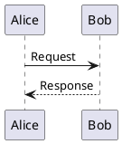
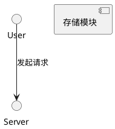
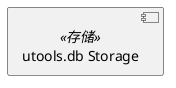
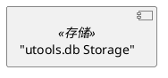
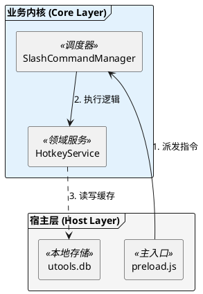
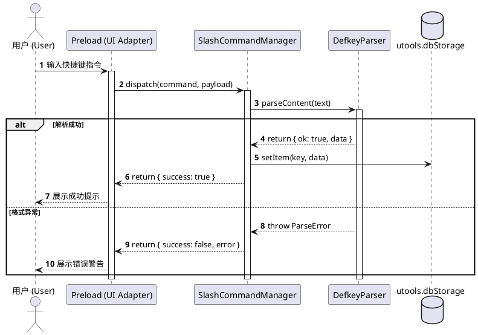

# PlantUML Lint & PNG Export Verification

## Overview

**All PlantUML diagrams in technical design documents must be syntactically valid and strictly exportable to PNG images without rendering failures.**

This skill provides automated linting, syntax checking, common error diagnostics, and PNG export validation for Markdown files and standalone `.puml` files.

---

## When to Use

```
Need to write or verify architecture/sequence diagrams?
    │
    ├── Is it PlantUML (@startuml ... @enduml)? ──► YES ──► Use this skill
    │
    └── Is it Mermaid / plain text flow? ────────► NO  ──► Use standard markdown / Mermaid
```

### Use when:
- Writing or reviewing design specs (`docs/spec/*.md`, `docs/design/*.md`) containing PlantUML blocks (` ```plantuml ` or ` ```puml `).
- Verifying that all UML diagrams can be successfully rendered and exported to `.png` / `.svg` without syntax errors.
- Troubleshooting PlantUML compilation failures, broken syntax, or unrendered diagram blocks.
- Running pre-commit or CI quality checks on documentation.

### When NOT to use:
- When writing pure Mermaid diagrams or ASCII flowcharts (PlantUML parser will not process Mermaid syntax).
- When writing non-graphical design sections (e.g. JSON schemas, pseudocode, markdown tables).

---

## Quick Reference

| Action | Command / Recipe |
|---|---|
| **One-Click Batch Lint & PNG Test** | `node .agents/skills/plantuml-lint/scripts/lint-plantuml.js [paths...]` |
| **Check Single Markdown File** | `node .agents/skills/plantuml-lint/scripts/lint-plantuml.js docs/design/architecture.md` |
| **Export PNGs to Directory** | `node .agents/skills/plantuml-lint/scripts/lint-plantuml.js -o ./dist/diagrams docs/design/` |
| **Syntax Check Only (no export)** | `node .agents/skills/plantuml-lint/scripts/lint-plantuml.js --check-only docs/spec/` |
| **Native PlantUML Syntax Check** | `plantuml --check-syntax <file>` |
| **Native PlantUML PNG Export** | `plantuml -png <file> -o <output_dir>` |

### PlantUML CLI Exit Codes
- `0`: Success (all diagrams valid and rendered).
- `50`: No file found.
- `100`: No diagram found (often caused by missing `@startuml` / `@enduml` delimiters).
- `200`: Diagram contains syntax errors.

---

## The 3 Hard Rules for PlantUML in Markdown

### 1. Delimiter Requirement (MANDATORY)
Every markdown ` ```plantuml ` or ` ```puml ` code block **MUST** contain explicit `@start...` and `@end...` tags:

<Bad>
```markdown
```plantuml
Alice -> Bob: Request
Bob --> Alice: Response
```
```
*(Fails with exit code 100: No diagram found)*
</Bad>

<Good>
```markdown

```
</Good>

### 2. Half-Width ASCII Punctuation Only
Never use full-width / Chinese punctuation in PlantUML syntax tokens, arrows, or labels without proper ASCII quotes:

<Bad>
```plantuml
@startuml
User ——> Server： 发起请求
[存储模块] as “DB”
@enduml
```
</Bad>

<Good>

</Good>

### 3. Quote Labels with Spaces / Symbols
When element names or stereotype labels contain special characters (`.`, `/`, `-`, spaces), wrap them in standard quotes or use aliases:

<Bad>

</Bad>

<Good>

</Good>

---

## Verification & Linting Workflow

```
1. Scan Markdown Files ──► 2. Validate @startuml/@enduml ──► 3. Test Pipe Syntax ──► 4. Verify PNG Export
```

### Step 1: Run Automated Lint Script
Run the workspace lint script to check all documentation:
```bash
node .agents/skills/plantuml-lint/scripts/lint-plantuml.js docs/
```

### Step 2: Fix Detected Errors
If errors are reported:
1. Locate the exact file and line number shown in the output.
2. Verify the closing brackets (`}`, `end`, `@enduml`).
3. Check for illegal Chinese punctuation or unquoted special characters.
4. Check Graphviz dependencies if class or component diagrams fail.

### Step 3: Verify PNG Export
Ensure that running the export test outputs a valid, non-empty PNG file:
```bash
node .agents/skills/plantuml-lint/scripts/lint-plantuml.js -o /tmp/puml_verify docs/spec/spec-xxxxx.md
```

---

## Common PlantUML Syntax Errors & Fixes

### 1. Architecture & Component Diagrams


### 2. Interaction Sequence Diagrams


---

## Rationalization Table

| Excuse | Reality |
|---|---|
| "Markdown preview renders fine in my IDE extension" | IDE extensions often auto-wrap loose snippets; PlantUML CLI and CI PNG export will fail without `@startuml ... @enduml`. |
| "It's just a typo in a Chinese colon `：`" | Chinese colons break message parsing and arrow routing in PlantUML. |
| "Syntax check passed, no need to test PNG export" | Syntax check doesn't catch Graphviz (`dot`) rendering crashes, memory exhaustion, or skinparam visual breakages. Always verify PNG export. |
| "Mermaid is faster to write" | In this project, `designer` subagent enforces PlantUML as a hard gate for architectural consistency and offline exportability. |

---

## Red Flags - STOP and Fix

- [ ] A ` ```plantuml ` block missing `@startuml` or `@enduml`.
- [ ] Diagram fails with exit code `100` or `200` when running `plantuml`.
- [ ] Exported `.png` file has a size of 0 bytes or is missing.
- [ ] Using Chinese quotes `“”` or full-width arrows `——>` inside diagrams.
- [ ] Unclosed `alt`, `opt`, `loop`, `group`, or `package` blocks.
