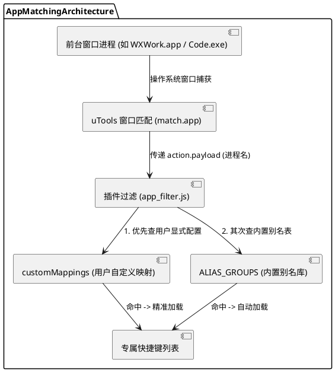

# 新应用快捷键接入与进程匹配配置指南

本文档详细说明在「快捷键助手」插件中如何为一个新应用配置进程映射与快捷键过滤，以确保在前台应用处于激活状态时，呼出 uTools 能够精准识别并加载专属快捷键列表。

---

## 1. 核心机制概述

插件在前台应用内部唤醒并匹配快捷键时，涉及两个层面的识别机制：

1. **uTools 窗口捕获层 (`match.app`)**：
   uTools 依赖操作系统底层的可执行进程文件名（macOS 为 `.app`，Windows 为 `.exe`）来捕获前台窗口并触发 `app_shortcuts` 模式。
2. **插件快捷键过滤层 (`app_filter.js`)**：
   插件接收到前台进程名后，通过 **`customMappings`（动态自定义映射）** 和 **`ALIAS_GROUPS`（静态内置别名库）** 双层逻辑，将进程名映射为对应快捷键数据集的 `appId`。



---

## 2. 方式一：通过 `ALIAS_GROUPS` 接入（插件开发者 / 静态内置方式）

适用于主流软件、跨平台通用软件或官方内置快捷键包的接入，提供**开箱即用**体验，用户无需做任何额外配置。

### 适用场景
- 该软件具备广泛的用户群体；
- 该软件在不同系统或版本下有多种已知进程名（例如 VS Code 在 Mac 为 `Visual Studio Code.app`，Win 为 `Code.exe`，华为云为 `CodeArts-IDE.exe`）。

### 步骤 1：确认快捷键数据的 `appId`
在快捷键 JSON 文件（如 `builtin/` 或 `cheatsheet/` 目录下）中定义规范的 `appId`：
```json
{
  "appId": "one-commander",
  "appName": "One Commander",
  "shortcuts": [ ... ]
}
```

### 步骤 2：在 `app_id_normalizer.js` 中添加别名组
编辑文件 [src/infrastructure/app_id_normalizer.js](file:///Users/guangyu/Projects/utools/utools_shortcut_keys/src/infrastructure/app_id_normalizer.js)，在 `ALIAS_GROUPS` 数组中追加该应用的所有常见进程名变体（均去掉扩展名并转小写）：

```javascript
const ALIAS_GROUPS = [
    ['vscode', 'visual-studio-code', 'visualstudiocode', 'codearts-ide', 'codeartside', 'codearts', 'vscode-huawei', 'code'],
    ['jet_brains', 'intellij-idea', 'jetbrains', 'idea'],
    // 新增应用别名组示例：
    ['one-commander', 'onecommander', 'one-commander-3', 'onecommander3']
];
```
> **规则说明**：
> - 别名组的**第一个元素**为规范 Canonical ID（建议与 JSON 中的 `appId` 去除横杠后保持一致）。
> - 组内所有后续别名，在经过 `normalizeAppId()` 处理后均会统一映射到第一个 Canonical ID。

### 步骤 3：在 `plugin.json` 中配置默认窗口监听
在 [plugin.json](file:///Users/guangyu/Projects/utools/utools_shortcut_keys/plugin.json) 的 `features[code="app_shortcuts"].cmds[0].match.app` 数组中添加对应的进程全名：
```json
"match": {
  "app": [
    "One Commander 3.app",
    "OneCommander.app",
    "onecommander.exe",
    "OneCommander.exe"
  ]
}
```

---

## 3. 方式二：通过 `customMappings` 接入（用户配置 / 动态绑定方式）

适用于用户自主导入自定义快捷键 JSON 文件、企业内网自研工具或未经预设的小众应用。

### 适用场景
- 用户导入了个人专属快捷键 JSON 文件；
- 软件进程名特殊或与现有的 `appId` 命名不规则；
- 无需修改插件源码，在 uTools 界面上即可完成绑定。

### 步骤 1：准备并导入快捷键 JSON 数据
在用户数据配置目录下的 `json_hotkeys/` 文件夹中放入你的 JSON 文件（例如 `my-keys/json_hotkeys/one-commander-3.json`）：
```json
{
  "appId": "one-commander-3",
  "appName": "One Commander 3",
  "shortcuts": [
    {
      "title": "Open parent folder (Backspace)",
      "keys": ["backspace"],
      "category": "Columns navigation"
    }
  ]
}
```

### 步骤 2：使用 `/app` 命令添加进程映射
1. 在 uTools 输入框输入 `hk` 或 `快捷键`，然后输入斜线命令 `/app`；
2. 列表中将展示所有已加载的应用，选择目标应用（如 `One Commander 3`）；
3. 点击 **「添加进程映射」** 选项；
4. 输入该应用在当前操作系统中的**真实可执行进程名**：
   - **macOS**：输入完整 App 包名（如 `One Commander 3.app` 或 `OneCommander.app`）；
   - **Windows**：输入可执行文件名（如 `OneCommander.exe` 或 `onecommander.exe`）；
5. 回车确认，插件会自动保存到 `customMappings`，并通过 `utools.setFeature()` 动态激活窗口监听。

---

## 4. 两种方式对比与选型建议

| 比较维度 | 方式一：`ALIAS_GROUPS` (内置别名) | 方式二：`customMappings` (用户映射) |
| :--- | :--- | :--- |
| **操作方式** | 修改代码并随版本发布 | uTools 界面通过 `/app` 命令交互配置 |
| **生效范围** | 所有安装该插件的用户全局生效 | 仅当前用户本机持久化生效 (`utools.dbStorage`) |
| **匹配优先级** | 第二优先级（标准推导） | 第一优先级（强行覆盖，绝对精准） |
| **适合对象** | 插件开发者、开源贡献者 | 插件使用者、自定义快捷键爱好者 |

---

## 5. 常见问题排查 (FAQ)

### Q1：配置后在应用内部呼出插件，为什么没有出来专属快捷键？
- **检查 1（进程名后缀）**：
  macOS 必须带有 `.app` 后缀，Windows 必须带有 `.exe` 后缀。不要填应用界面的中文名称或窗口标题栏文字。
- **检查 2（大小写精确度）**：
  macOS 的部分应用对 `.app` 的英文大小写和空格敏感，请在「活动监视器」或 `/Applications` 目录下核对确切的 Bundle 名称。
- **检查 3（数据是否加载）**：
  在全局主搜索框（输入 `hk`）中尝试搜索该应用的某条快捷键。若全局都搜不到，说明 JSON 格式有误或未放入正确的数据目录下。

### Q2：如何查看或删除已绑定的进程名？
输入 `/app` 选中该应用后，点击 **「查看所有自定义映射」**，即可查看当前绑定的进程列表，或点击单独删除某项映射、一键重置为默认推导。
