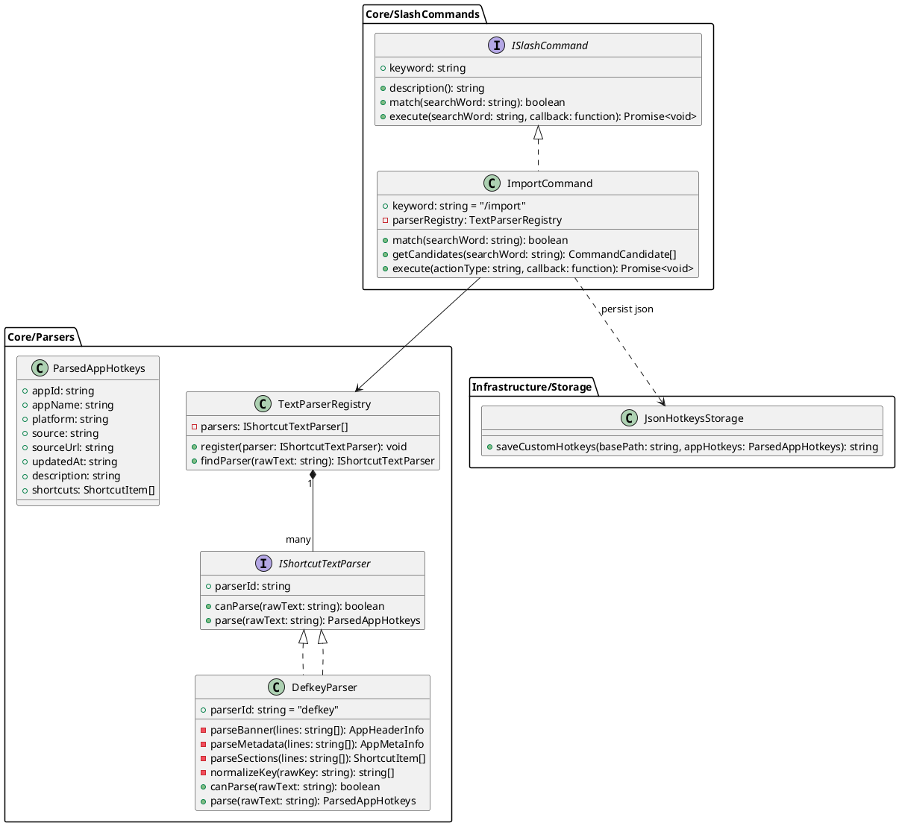
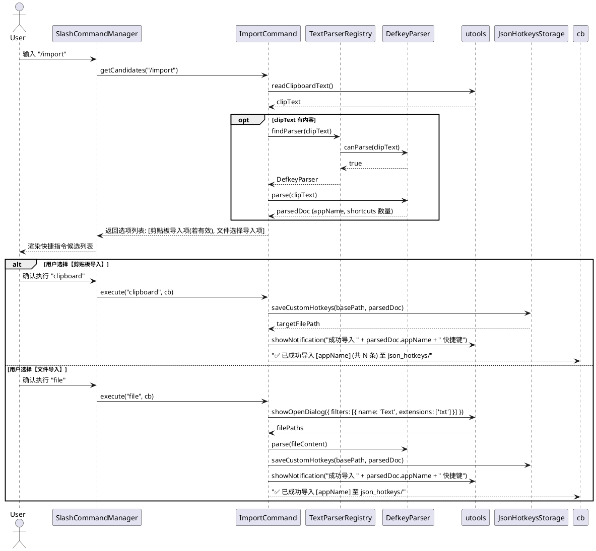

# SPEC-00015: 支持 Defkey 导出文本格式快捷键导入

## 1. 功能目标与背景
- **核心目标**: 支持用户将来自 Defkey (defkey.com) 网站导出的纯文本快捷键格式（如 `One Commander 3 keyboard shortcuts.txt`）一键解析并转换为插件标准的 JSON 快捷键配置，自动存储至用户自定义快捷键目录（`{basePath}/json_hotkeys/`），丰富离线/自定义快捷键生态。
- **非目标 (Non-Goals)**: 
  - 本期不直接集成爬取 defkey.com 网页的爬虫功能，仅专注于本地纯文本（文件或剪贴板）的解析与转换。
  - 本期不包含快捷键冲突的交互式合并编辑器（采用文件覆盖或同名更新策略）。

---

## 2. 用户操作流程 (User Flow)

```
[用户触发导入]
       │
       ▼
   输入 "/import"
       │
       ├─► [剪贴板检测成功] ──► 显示 "📥 导入剪贴板中的 [应用名] (共 N 条快捷键)"
       │                              │
       │                              ▼ (回车)
       │                         写入 {basePath}/json_hotkeys/{appId}.json
       │                              │
       │                              ▼
       │                         通知 "成功导入 [应用名] 快捷键"
       │
       └─► [选择文件模式] ──► 显示 "📁 选择 Defkey 文本文件 (.txt) 导入..."
                                      │
                                      ▼ (回车)
                                 弹出系统文件选择框
                                      │
                                      ▼ (选择 .txt)
                                 解析内容并写入 {basePath}/json_hotkeys/{appId}.json
                                      │
                                      ▼
                                 通知 "成功导入 [应用名] 快捷键"
```

1. **唤起指令**: 用户在 uTools 搜索框中输入 `/import`。
2. **智能状态感知**:
   - 插件自动探测系统剪贴板文本：
     - 若剪贴板文本符合 Defkey 导出特征（包含 `keyboard shortcuts` 标题、URL 及分隔线等），在搜索列表中置顶展示 `📥 导入剪贴板中的 [AppName] 快捷键 (共 N 条)`。
     - 同时提供 `📁 选择 Defkey 导出文本文件 (.txt) 导入...` 选项。
3. **确认执行**:
   - **剪贴板导入**: 用户回车选中剪贴板导入项，插件直接解析剪贴板内容，生成 `{appId}.json` 并存入 `{basePath}/json_hotkeys/`。
   - **文件导入**: 用户选择文件选项，插件调用 `utools.showOpenDialog` 选择本地 `.txt` 文件，读取并解析后保存。
4. **即时生效与反馈**:
   - 保存后自动触发快捷键重新加载，弹出系统通知提示“成功导入 [AppName] 的 N 条快捷键”。

---

## 3. 详细架构与逻辑设计

### 3.1 核心设计原则 (HARD_GATE)
- **SOLID 原则**:
  - **SRP (单一职责)**: `DefkeyParser` 仅专注于 Defkey 纯文本语法解析与标准化 AST 生成；`ImportCommand` 专注于 Slash 命令交互与剪贴板/文件 I/O 调度；存储路径管理复用统一配置。
  - **OCP (开闭原则)**: 定义通用的 `IShortcutTextParser` 接口，后续如需扩展其他站点（如 CheatSheet、Key Combiner）导出格式，仅需新增对应 Parser 实现类，无需改动 `ImportCommand` 主流程。
  - **DIP (依赖倒置)**: `ImportCommand` 依赖抽象接口 `IShortcutTextParser`，而非硬编码具体实现。
- **设计语言优先**: 严禁直接编写具体实现代码，全面采用 PlantUML 架构/时序图及高阶伪代码阐述。

---

### 3.2 软件架构类图 (PlantUML)



---

### 3.3 交互时序图 (PlantUML)



---

### 3.4 核心算法与按键归一化设计 (Pseudocode)

#### 1. Defkey 文本解析逻辑
```text
ALGORITHM ParseDefkeyText(rawText):
    lines = Split rawText into lines, trim each line
    IF lines.length < 5 THEN
        THROW "Invalid Defkey format: content too short"

    // 1. 提取 Header Banner (=== 包裹的第二行)
    bannerMatch = Extract text between '===' lines
    appName = RemoveSuffix(bannerMatch, " keyboard shortcuts")

    // 2. 提取 URL 与 appId Slug
    sourceUrl = RegexExtract(rawText, "https://defkey.com/([a-zA-Z0-9_-]+)-shortcuts")
    appId = NormalizeAppSlug(sourceUrl.slug) OR GenerateAppId(appName)

    // 3. 提取 Section 与 Shortcuts
    currentSection = "General"
    shortcutsList = []
    
    FOR EACH line IN contentBodyLines:
        IF line followed by '---' line THEN
            currentSection = line.trim()
            SKIP NEXT LINE
        ELSE IF line contains shortcut separator (two or more spaces / tabs) THEN
            (rawKey, rawTitle) = SplitByMultipleSpaces(line, maxSplit=2)
            normalizedKeys = NormalizeKeyCombination(rawKey)
            (cleanTitle, description) = ParseTitleAndDescription(rawTitle)
            
            APPEND {
                title: cleanTitle,
                keys: normalizedKeys,
                section: currentSection,
                description: description
            } TO shortcutsList

    RETURN {
        appId: appId,
        appName: appName,
        platform: DetectPlatform(rawText),
        source: "defkey",
        sourceUrl: sourceUrl,
        updatedAt: ExtractDate(rawText) OR CurrentDate(),
        shortcuts: shortcutsList
    }
```

#### 2. 按键归一化映射 (Key Combination Normalization)
```text
ALGORITHM NormalizeKeyCombination(rawKeyStr):
    // 处理序列组合键，如 "\ then Ctrl + C" -> ["\\", "then", "{cmd_or_ctrl}", "c"]
    parts = SplitBySequenceDelimiter(rawKeyStr, " then ")
    resultKeys = []

    FOR EACH part IN parts:
        keys = Split part by "+"
        FOR EACH k IN keys:
            cleanKey = Lowercase(Trim(k))
            SWITCH cleanKey:
                CASE "ctrl", "control":
                    PUSH "{cmd_or_ctrl}"
                CASE "alt", "option", "opt":
                    PUSH "{opt_or_alt}"
                CASE "shift":
                    PUSH "shift"
                CASE "win", "windows", "cmd", "command":
                    PUSH "win"
                CASE "up arrow":
                    PUSH "up"
                CASE "down arrow":
                    PUSH "down"
                CASE "left arrow":
                    PUSH "left"
                CASE "right arrow":
                    PUSH "right"
                CASE "del":
                    PUSH "delete"
                DEFAULT:
                    PUSH cleanKey
        IF hasNextPart THEN
            PUSH "then"

    RETURN resultKeys
```

---

### 3.5 数据与存储设计
- **保存目标目录**: `{basePath}/json_hotkeys/{appId}.json`（若用户未配置 `basePath`，通过 `utools.dbStorage` 读取默认存储根路径）。
- **文件命名规则**: `{appId}.json`（例如 `one-commander-3.json`）。
- **加载优先级保障**: 因为保存在 `json_hotkeys/` 目录下，`JsonHotkeysLoader` 会以最高优先级加载，覆盖同名的内置或在线下载快捷键。

---

## 4. 测试用例设计 (Test Design)

### 4.1 单元测试矩阵 (Unit Tests)

| 用例 ID | 模块 / 场景 | 测试输入 | 预期结果 |
| :--- | :--- | :--- | :--- |
| **UT-01** | `DefkeyParser.canParse` | `One Commander 3 keyboard shortcuts.txt` 头部文本 | 返回 `true` |
| **UT-02** | `DefkeyParser.canParse` | 普通文本或 Markdown 文档 | 返回 `false` |
| **UT-03** | 基础元数据解析 | 样本 Banner、URL 及更新时间 | 提取 `appName="One Commander 3"`, `appId="one-commander-3"`, `sourceUrl` 正确 |
| **UT-04** | 分组与快捷键解析 | `Program operations` 分组与 `Ctrl + Shift + F12` | 生成对应 section，keys 映射为 `["{cmd_or_ctrl}", "shift", "f12"]` |
| **UT-05** | 特殊键转换 | `Alt + Up arrow`, `Del`, `Shift + F10` | 转换映射为 `["{opt_or_alt}", "up"]`, `["delete"]`, `["shift", "f10"]` |
| **UT-06** | 连续按键转换 | `\ then Ctrl + C` | 转换为 `["\\", "then", "{cmd_or_ctrl}", "c"]` |
| **UT-07** | 标题与备注拆分 | `(if no file is selected) Copy current path` | 正确提取 title 与 description |
| **UT-08** | 非法与空文本容错 | 空字符串、缺少按键分割线的坏数据 | 优雅抛出语义化错误或跳过无效行，不发生未捕获异常崩溃 |

### 4.2 集成测试与验证 (Integration Verification)
- **剪贴板完整链路**: Mock 剪贴板注入 `One Commander 3` 样本 ➡️ 执行 `/import` ➡️ 验证 `json_hotkeys/one-commander-3.json` 成功生成且内容结构符合规范。
- **加载器无缝接入**: 运行现有 `npm test` 验证 `JsonHotkeysLoader` 与 `ShortcutsLoader` 能正常读取并去重。

---

## 5. 任务拆分清单 (Task Checklist)

### 阶段一：解析器核心与单测 (Phase 1: Defkey Parser & TDD)
- [ ] **任务 1.1: 创建 `IShortcutTextParser` 接口与 `TextParserRegistry`**
  - 🔴 测试: 编写 `test/test_text_parser_registry.js`。
  - 🟢 实现: 实现 `src/core/parsers/text_parser_registry.js`。
  - 🔵 验证: `npm test` 绿灯。
- [ ] **任务 1.2: 实现 `DefkeyParser` 核心元数据与按键解析**
  - 🔴 测试: 编写 `test/test_defkey_parser.js`，包含 UT-01 ~ UT-08 完整用例。
  - 🟢 实现: 实现 `src/core/parsers/defkey_parser.js`。
  - 🔵 验证: `npm test` 绿灯。

### 阶段二：命令分发与存储集成 (Phase 2: Slash Command & Storage)
- [ ] **任务 2.1: 实现 `ImportCommand` 斜线命令**
  - 🔴 测试: 编写 `test/test_import_command.js`，Mock 剪贴板与文件对话框。
  - 🟢 实现: 实现 `src/core/slash_commands/import.js` 并接入 `slash_commands/index.js`。
  - 🔵 验证: `npm test` 绿灯。
- [ ] **任务 2.2: 端到端集成测试与样本验证**
  - 🔴 测试: 编写 `test/test_defkey_integration.js`，使用真实样本进行解析和加载验证。
  - 🟢 实现: 完善存储路径校验与错误提示。
  - 🔵 验证: 全量 `npm test` 通过。
