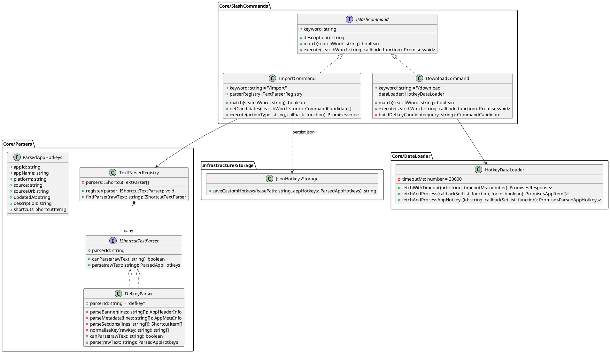
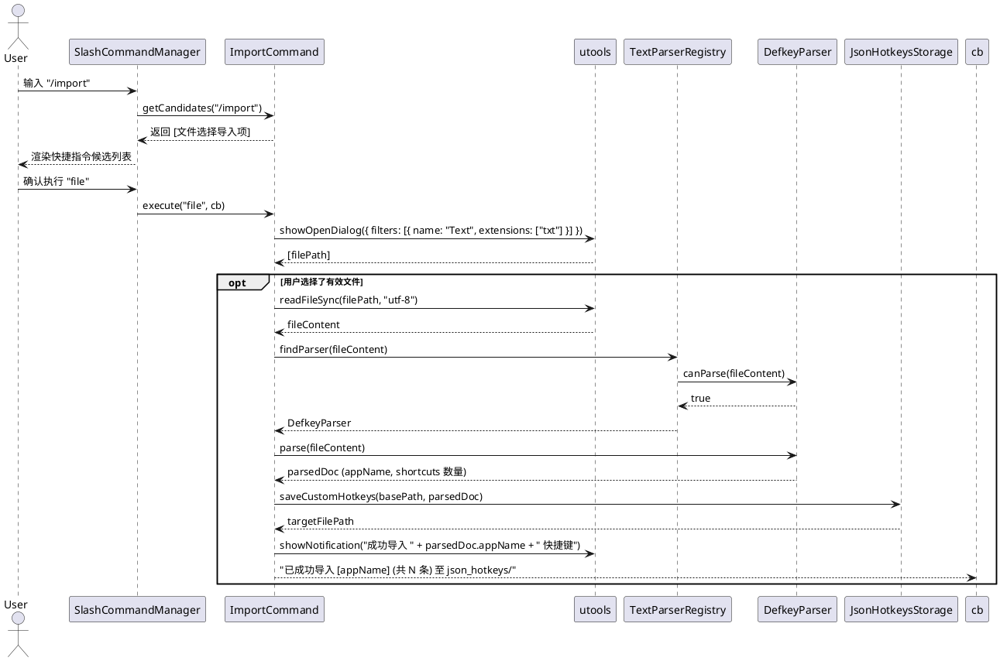
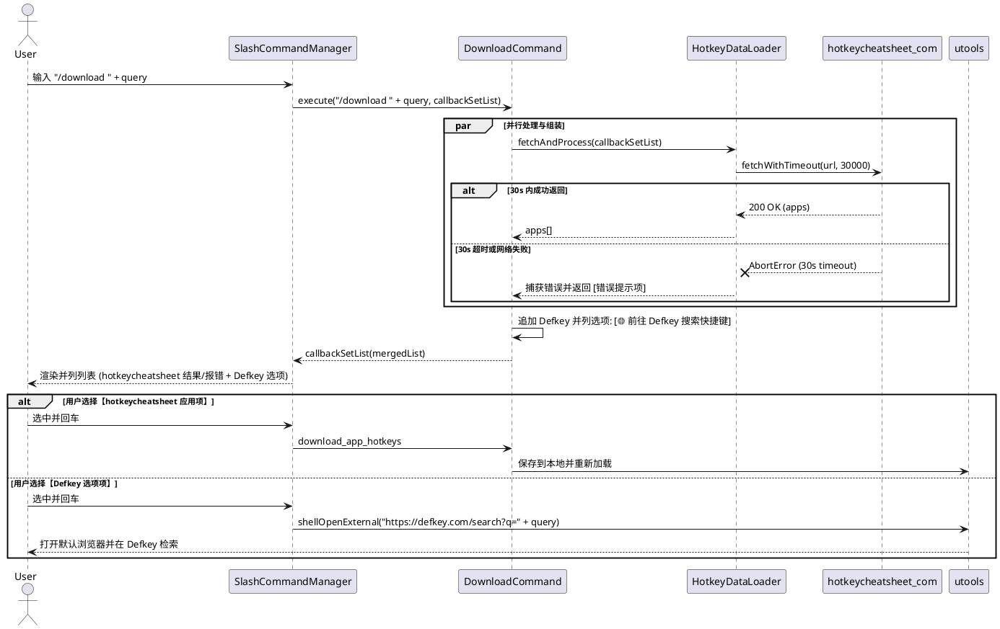

# SPEC-00015: 支持 Defkey 文本导入与 /download 双源并列与超时降级机制

## 1. 功能目标与背景
- **核心目标**: 
  1. **Defkey 文本导入**: 支持用户将来自 Defkey (defkey.com) 网站导出的纯文本快捷键文件（如 `One Commander 3 keyboard shortcuts.txt`）通过 `/import` 命令一键解析并转换为插件标准的 JSON 快捷键配置，自动存储至用户自定义快捷键目录（`{basePath}/json_hotkeys/`），丰富离线与自定义快捷键生态。
  2. **`/download` 双源并列与 30s 超时容错**:
     - **双源并列展示**: 用户执行 `/download <应用名>` 时，候选列表将 **hotkeycheatsheet 在线快捷键条目** 与 **Defkey 检索选项** 作为并列列表项一同展示，为用户提供双通道数据来源。
     - **30s 超时控制**: 当请求 hotkeycheatsheet.com 获取列表或详情时，设置 30 秒请求超时；若超时或网络中断，hotkeycheatsheet 项在列表中展示错误提示（如 `❌ hotkeycheatsheet 连接超时 (30s)`），而并列的 Defkey 引导项不受影响，用户仍可一键跳转 Defkey 导出文本并通过 `/import` 导入。
- **非目标 (Non-Goals)**: 
  - 本期不直接集成爬取 defkey.com 网页的爬虫功能。
  - 本期不支持复制粘贴/剪贴板文本导入，仅专注于本地纯文本文件（.txt）的解析与传输。
  - 本期不包含快捷键冲突的交互式合并编辑器（采用文件覆盖或同名更新策略）。

---

## 2. 用户操作流程 (User Flow)

### 2.1 流程 A: 纯文本文件导入 (`/import`)

```
[用户触发导入]
       │
       ▼
   输入 "/import"
       │
       ▼
   展示 "📁 选择 Defkey 文本文件 (.txt) 导入..."
       │
       ▼ (回车)
   弹出系统文件选择框 (选择 .txt 文件)
       │
       ▼
   读取并解析文本内容
       │
       ▼
   写入 {basePath}/json_hotkeys/{appId}.json
       │
       ▼
   通知 "成功导入 [应用名] 快捷键 (共 N 条)"
```

1. **唤起指令**: 用户在 uTools 搜索框中输入 `/import`。
2. **选择文件**: 插件展示 `📁 选择 Defkey 导出文本文件 (.txt) 导入...` 候选选项。
3. **确认执行**:
   - 用户回车确认，插件调用 `utools.showOpenDialog` 选择本地 `.txt` 快捷键文本文件。
   - 读取文件内容并通过解析器进行语法校验与解析。
4. **即时生效与反馈**:
   - 解析成功后生成 `{appId}.json` 写入 `{basePath}/json_hotkeys/`。
   - 自动触发快捷键重新加载，弹出系统通知提示“成功导入 [AppName] 的 N 条快捷键”。

---

### 2.2 流程 B: `/download` 双源并列与超时容错

```
[用户触发下载]
       │
       ▼
   输入 "/download <应用名>"
       │
       ├─────────────────────────────────────────┐
       ▼ (30s 内成功返回)                          ▼ (超过 30s 或网络失败)
   展示并列候选列表:                             展示并列候选列表:
   ├─► [hotkeycheatsheet] 应用 1 快捷键          ├─► [❌ hotkeycheatsheet 连接超时 (30s)]
   ├─► [hotkeycheatsheet] 应用 2 快捷键          │
   └─► [🌐 Defkey] 前往 Defkey 搜索该应用        └─► [🌐 Defkey] 前往 Defkey 搜索该应用
              │                                             │
              ├─► (回车 hotkeycheatsheet 项)                └─► (回车 Defkey 项)
              │    下载并写入本地                                浏览器打开 defkey.com/search?q=...
              │                                                 下载 .txt 后通过 /import 导入
              └─► (回车 Defkey 项)
                   浏览器打开 defkey.com/search?q=...
```

1. **触发下载**: 用户在搜索框输入 `/download` 或 `/download <appName>`。
2. **双源候选组装**:
   - **HotkeyCheatsheet 来源**: `HotkeyDataLoader` 向 hotkeycheatsheet.com 发起请求（带 30s `AbortController` 超时机制）。
     - 成功：列出匹配的应用条目。
     - 超时/失败：显示 `❌ hotkeycheatsheet 连接超时 (30s)` 错误列表项。
   - **DefKey 来源**: 无论 hotkeycheatsheet 成功或失败，列表末尾始终**并列追加**一个 Defkey 列表项：
     - 标题: `🌐 前往 Defkey 搜索 [应用名] 快捷键`
     - 描述: `在线导出 .txt 文本后使用 /import 命令一键导入本地`
3. **用户选择执行**:
   - **选中 HotkeyCheatsheet 项**: 一键下载在线 JSON/HTML 快捷键并保存至本地。
   - **选中 Defkey 选项**: 调用 `utools.shellOpenExternal` 打开系统默认浏览器跳转到 `https://defkey.com/search?q=${encodeURIComponent(query)}`，引导用户下载文本文件后通过 `/import` 导入。

---

## 3. 详细架构与逻辑设计

### 3.1 核心设计原则 (HARD_GATE)
- **SOLID 原则**:
  - **SRP (单一职责)**: `DefkeyParser` 仅专注于 Defkey 纯文本语法解析与标准化 AST 生成；`ImportCommand` 专注于 Slash 命令交互与文件 I/O 调度；`DownloadCommand` 专注于聚合双数据源与超时降级；`HotkeyDataLoader` 专注于网络获取与超时控制。
  - **OCP (开闭原则)**: 定义通用的 `IShortcutTextParser` 接口，后续如需扩展其他站点（如 CheatSheet、Key Combiner）导出格式，仅需新增对应 Parser 实现类，无需改动 `ImportCommand` 主流程。
  - **DIP (依赖倒置)**: `ImportCommand` 依赖抽象接口 `IShortcutTextParser`，而非硬编码具体实现。
- **设计语言优先**: 严禁直接编写具体生产代码，全面采用 PlantUML 架构/时序图及高阶伪代码阐述。

---

### 3.2 软件架构类图 (PlantUML)



---

### 3.3 交互时序图 (PlantUML)

#### 时序图 1: `/import` 文件导入时序



#### 时序图 2: `/download` 双源并列与超时时序



---

### 3.4 核心算法与高阶伪代码 (Pseudocode)

#### 1. 双源并列候选列表生成与 30s 超时控制
```text
ALGORITHM ExecuteDownloadCommand(searchWord, callbackSetList):
    query = ExtractQuery(searchWord, keyword="/download")
    TIMEOUT_LIMIT = 30000 // 30s

    // 1. 构建常态并列的 Defkey 选项
    searchTarget = Trim(query)
    defkeyUrl = searchTarget ? ("https://defkey.com/search?q=" + UrlEncode(searchTarget)) : "https://defkey.com/"
    defkeyItem = {
        title: "🌐 前往 Defkey 搜索 " + (searchTarget ? ("[" + searchTarget + "]") : "") + " 快捷键",
        description: "前往 defkey.com 导出 .txt 文本后使用 /import 命令一键导入",
        icon: "icons/browser.png",
        action: "open_external_url",
        url: defkeyUrl
    }

    // 2. 拉取 hotkeycheatsheet 列表 (带 30s 超时控制)
    TRY:
        apps = AWAIT dataLoader.fetchWithTimeout(TIMEOUT_LIMIT)
        filteredApps = FilterByQuery(apps, query)
        hotkeyItems = MapToCandidates(filteredApps, action="download_app_hotkeys")
        
        // 双源并列: hotkeycheatsheet 项 + Defkey 选项
        displayList = hotkeyItems.concat([defkeyItem])
        callbackSetList(displayList)
    CATCH error:
        isTimeout = (error.name == "AbortError" OR error.message CONTAINS "timeout")
        errorMsg = isTimeout ? "连接 hotkeycheatsheet.com 超时 (30s)" : ("请求失败: " + error.message)
        errorItem = {
            title: "❌ " + errorMsg,
            description: "在线数据源连接异常，建议稍后重试或使用下方 Defkey 选项",
            icon: "icons/error.png",
            action: "noop"
        }
        
        // 报错与 Defkey 选项并列
        callbackSetList([errorItem, defkeyItem])
```

#### 2. Defkey 文本解析逻辑
```text
ALGORITHM ParseDefkeyText(rawText):
    lines = Split rawText into lines, trim each line
    IF lines.length < 5 THEN
        THROW "Invalid Defkey format: content too short"

    // 1. 提取 Header Banner (=== 包裹的第二行)
    bannerMatch = Extract text between "===" lines
    appName = RemoveSuffix(bannerMatch, " keyboard shortcuts")

    // 2. 提取 URL 与 appId Slug
    sourceUrl = RegexExtract(rawText, "https://defkey.com/([a-zA-Z0-9_-]+)-shortcuts")
    appId = NormalizeAppSlug(sourceUrl.slug) OR GenerateAppId(appName)

    // 3. 提取 Section 与 Shortcuts
    currentSection = "General"
    shortcutsList = []
    
    FOR EACH line IN contentBodyLines:
        IF line followed by "---" line THEN
            currentSection = line.trim()
            SKIP NEXT LINE
        ELSE IF line contains shortcut separator (two or more spaces / tabs) THEN
            (rawKey, rawTitle) = SplitByMultipleSpaces(line, maxSplit=2)
            normalizedKeys = NormalizeKeyCombination(rawKey)
            (cleanTitle, description) = ParseTitleAndDescription(rawTitle)
            
            APPEND {
                title: cleanTitle,
                keys: normalizedKeys,
                section: currentSection,
                description: description
            } TO shortcutsList

    RETURN {
        appId: appId,
        appName: appName,
        platform: DetectPlatform(rawText),
        source: "defkey",
        sourceUrl: sourceUrl,
        updatedAt: ExtractDate(rawText) OR CurrentDate(),
        shortcuts: shortcutsList
    }
```

#### 3. 按键归一化映射 (Key Combination Normalization)
```text
ALGORITHM NormalizeKeyCombination(rawKeyStr):
    // 处理序列组合键，如 " then Ctrl + C" -> ["\", "then", "{cmd_or_ctrl}", "c"]
    parts = SplitBySequenceDelimiter(rawKeyStr, " then ")
    resultKeys = []

    FOR EACH part IN parts:
        keys = Split part by "+"
        FOR EACH k IN keys:
            cleanKey = Lowercase(Trim(k))
            SWITCH cleanKey:
                CASE "ctrl", "control":
                    PUSH "{cmd_or_ctrl}"
                CASE "alt", "option", "opt":
                    PUSH "{opt_or_alt}"
                CASE "shift":
                    PUSH "shift"
                CASE "win", "windows", "cmd", "command":
                    PUSH "win"
                CASE "up arrow":
                    PUSH "up"
                CASE "down arrow":
                    PUSH "down"
                CASE "left arrow":
                    PUSH "left"
                CASE "right arrow":
                    PUSH "right"
                CASE "del":
                    PUSH "delete"
                DEFAULT:
                    PUSH cleanKey
        IF hasNextPart THEN
            PUSH "then"

    RETURN resultKeys
```

---

### 3.5 数据与存储设计
- **保存目标目录**: `{basePath}/json_hotkeys/{appId}.json`（若用户未配置 `basePath`，通过 `utools.dbStorage` 读取默认存储根路径）。
- **文件命名规则**: `{appId}.json`（例如 `one-commander-3.json`）。
- **加载优先级保障**: 因为保存在 `json_hotkeys/` 目录下，`JsonHotkeysLoader` 会以最高优先级加载，覆盖同名的内置或在线下载快捷键。

---

## 4. 测试用例设计 (Test Design)

### 4.1 单元测试矩阵 (Unit Tests)

| 用例 ID | 模块 / 场景 | 测试输入 | 预期结果 |
| :--- | :--- | :--- | :--- |
| **UT-01** | `DefkeyParser.canParse` | `One Commander 3 keyboard shortcuts.txt` 头部文本 | 返回 `true` |
| **UT-02** | `DefkeyParser.canParse` | 普通文本或 Markdown 文档 | 返回 `false` |
| **UT-03** | 基础元数据解析 | 样本 Banner、URL 及更新时间 | 提取 `appName="One Commander 3"`, `appId="one-commander-3"`, `sourceUrl` 正确 |
| **UT-04** | 分组与快捷键解析 | `Program operations` 分组与 `Ctrl + Shift + F12` | 生成对应 section，keys 映射为 `["{cmd_or_ctrl}", "shift", "f12"]` |
| **UT-05** | 特殊键转换 | `Alt + Up arrow`, `Del`, `Shift + F10` | 转换映射为 `["{opt_or_alt}", "up"]`, `["delete"]`, `["shift", "f10"]` |
| **UT-06** | 连续按键转换 | `\ then Ctrl + C` | 转换为 `["\\", "then", "{cmd_or_ctrl}", "c"]` |
| **UT-07** | 标题与备注拆分 | `(if no file is selected) Copy current path` | 正确提取 title 与 description |
| **UT-08** | 非法与空文本容错 | 空字符串、缺少按键分割线的坏数据 | 优雅抛出语义化错误或跳过无效行，不发生未捕获异常崩溃 |
| **UT-09** | `download` 正常返回并列 Defkey 选项 | `/download vscode` 成功拉取 | 列表同时包含 `VS Code (hotkeycheatsheet)` 及 `🌐 前往 Defkey 搜索 [vscode] 快捷键` |
| **UT-10** | `download` 30s 请求超时并列展示 | Mock 延迟 31s 响应的请求 | 列表同时包含 `❌ 连接 hotkeycheatsheet.com 超时 (30s)` 及 `🌐 前往 Defkey 搜索快捷键` |

### 4.2 集成测试与验证 (Integration Verification)
- **文件导入完整链路**: Mock 文件选择与读取 `One Commander 3` 样本 ➡️ 执行 `/import` ➡️ 验证 `json_hotkeys/one-commander-3.json` 成功生成且内容结构符合规范。
- **双源并列与超时链路**:
  - 场景 1: 在线正常时，验证 `/download` 结果中 hotkeycheatsheet 结果项与 Defkey 选项并列展示。
  - 场景 2: 在线超时 30s 时，验证 `/download` 结果中报错项与 Defkey 选项并列展示，点击 Defkey 选项成功触发 `utools.shellOpenExternal`。
- **加载器无缝接入**: 运行现有 `npm test` 验证 `JsonHotkeysLoader` 与 `ShortcutsLoader` 能正常读取并去重。
