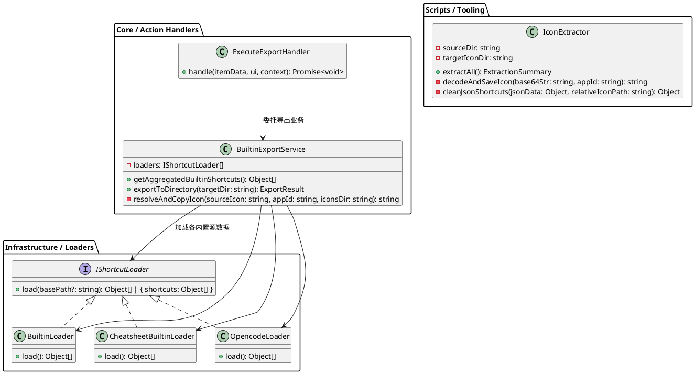
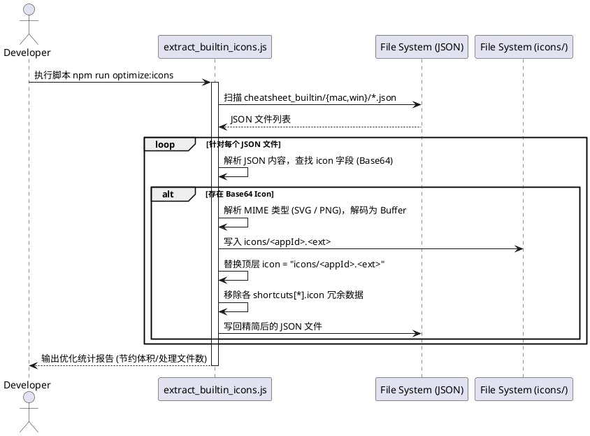
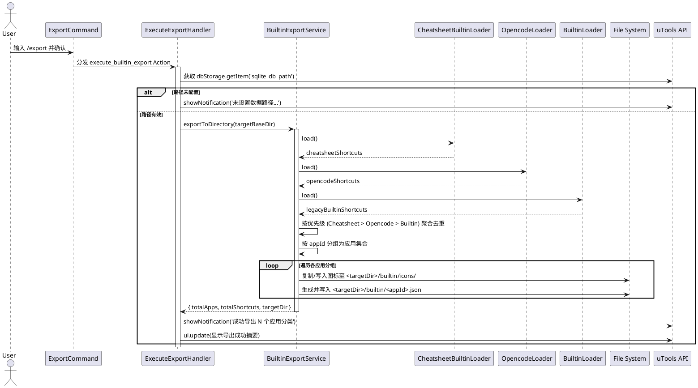

# SPEC-00016: 支持全量内置 Loader 数据导出与 CheatSheet 图标外置瘦身

## 1. 功能目标与背景

### 1.1 核心痛点与目标
1. **全量数据导出支持 (/export)**：
   - 现有 `/export` 斜线命令仅调用了旧版 `BuiltinLoader`，只能导出 11 个旧硬编码应用数据，无法导出后续新增的 `CheatsheetBuiltinLoader`（桌面端 CheatSheet 数据）及 `OpencodeLoader`（OpenCode 内置数据）。
   - **目标**：重构导出体系，统一接入当前运行环境支持的所有内置加载器（Builtin / Cheatsheet / Opencode），按应用进行优先级聚合与去重后，完整导出至用户配置的数据目录 `<savedPath>/builtin/`，同时自动同步导出对应的应用图标至 `<savedPath>/builtin/icons/`。
2. **CheatSheet 内置数据体积优化（图标外置化工具）**：
   - 目前 `src/infrastructure/data/cheatsheet_builtin/mac/*.json` 与 `win/*.json` 中，每个快捷键条目均大量冗余内嵌了完整的 Base64 图标数据（单文件膨胀至 200KB~450KB，总计逾 6MB）。
   - **目标**：设计并编写独立的图标提取与外置工具（`scripts/extract_builtin_icons.js` 或类似工具），将内嵌的 SVG/PNG 图标解码保存为 `icons/` 目录下的物理图标文件（如 `icons/google-chrome.svg`），并将 JSON 内冗余的 Base64 替换为精简的相对路径引用或由顶层统一声明，将内置数据体积缩减 90% 以上。

### 1.2 非目标 (Non-Goals)
- 本次重构不修改 `ShortcutsLoader` 既有的运行时优先级规则（`json_hotkeys` > `cheatsheet_builtin` > `opencode` > `builtin` > `hotkeycheatsheet`）。
- 不改变已导出的用户数据格式，保持与 SPEC-00010 统一 JSON Schema 完全兼容。

---

## 2. 用户操作与执行流程 (User Flow)

### 2.1 开发者/构建维护流：图标提取与瘦身 (Extract & Optimize Icons)
1. 开发者在终端执行 `npm run optimize:icons` 或 `node scripts/extract_builtin_icons.js`。
2. 脚本扫描 `src/infrastructure/data/cheatsheet_builtin/` 目录下的所有平台（`mac` / `win`）JSON 文件。
3. 提取其中内嵌的 `data:image/svg+xml;base64,...` 或 `data:image/png;base64,...` 图标数据，解码并保存为 `icons/<appId>.svg` 或 `icons/<appId>.png`。
4. 清洗 JSON 数据：剔除各 shortcut 内部重复的 Base64 字段，顶层 `icon` 指向 `icons/<appId>.svg` 相对路径。
5. 回写 JSON 文件并输出统计报告（提取图标数、瘦身前后文件大小对比）。

### 2.2 终端用户流：全量内置数据导出 (/export)
1. 用户在 uTools 搜索框输入 `/export`，插件展示 `确认导出所有内置快捷键` 选项。
2. 用户回车触发，系统获取用户已配置的数据存储路径（若未配置则提示先使用 `/path` 配置）。
3. 插件调度内置数据导出器，聚合所有内置 Loader（`BuiltinLoader`、`CheatsheetBuiltinLoader`、`OpencodeLoader`）的数据并按平台与规范去重。
4. 插件在目标路径 `<savedPath>/builtin/` 写入各应用的 `{appId}.json`，并在 `<savedPath>/builtin/icons/` 下输出所有关联的应用图标。
5. 界面弹出导出成功通知，并展示导出的应用数与文件总数。

---

## 3. 详细架构与逻辑设计

### 3.1 架构分层与 SOLID 原则遵循
- **单一职责原则 (SRP)**：
  - `IconExtractor`：专门负责扫描、解码并提取 Base64 图标，更新 JSON 引用关系。
  - `BuiltinExportService`：专门负责调度内置加载器、数据聚合去重、图标复制与文件输出。
  - `ExecuteExportHandler`：专注于响应 uTools 操作事件并调用 ExportService。
- **开闭原则 (OCP) 与依赖倒置 (DIP)**：
  - 导出服务面向 Loader 抽象，后续若新增新的内置 Loader，仅需注入到内置源加载器列表中即可自动支持导出。

### 3.2 软件架构与类图 (PlantUML)



### 3.3 交互时序图 1：图标提取外置工具流程 (PlantUML)



### 3.4 交互时序图 2：全量内置数据导出流程 (/export) (PlantUML)



---

## 4. 核心逻辑与伪代码 (Pseudocode)

### 4.1 图标外置工具算法伪代码 (`extract_builtin_icons.js`)
```
FUNCTION extractAllBuiltinIcons():
    targetIconsDir = "icons"
    dataDirs = ["src/infrastructure/data/cheatsheet_builtin/mac", "src/infrastructure/data/cheatsheet_builtin/win"]
    
    FOR EACH dataDir IN dataDirs:
        files = listJsonFiles(dataDir)
        FOR EACH file IN files:
            doc = parseJson(file.path)
            appId = doc.appId
            
            // 提取有效 Base64 图标（优先从顶层或第一条快捷键提取）
            rawIcon = doc.icon OR (doc.shortcuts[0] ? doc.shortcuts[0].icon : null)
            IF rawIcon STARTS WITH "data:":
                mimeType, base64Data = parseDataUri(rawIcon)
                extension = (mimeType CONTAINS "svg") ? "svg" : "png"
                iconFileName = appId + "." + extension
                iconDiskPath = path.join(targetIconsDir, iconFileName)
                
                // 写入物理文件
                writeFile(iconDiskPath, base64Decode(base64Data))
                
                // 更新 JSON 引用
                doc.icon = "icons/" + iconFileName
            
            // 清理子条目中重复的 Base64
            FOR EACH shortcut IN doc.shortcuts:
                IF shortcut.icon STARTS WITH "data:":
                    DELETE shortcut.icon // 继承应用顶层 icon，无需重复存储
            
            // 保存格式化后的 JSON
            writeJsonFile(file.path, doc)
```

### 4.2 全量内置导出聚合算法 (`BuiltinExportService`)
```
FUNCTION getAggregatedBuiltinShortcuts():
    loaders = [
        { name: 'CheatsheetBuiltinLoader', inst: new CheatsheetBuiltinLoader() },
        { name: 'OpencodeLoader', inst: new OpencodeLoader() },
        { name: 'BuiltinLoader', inst: new BuiltinLoader() }
    ]
    
    claimedApps = Set()
    allShortcuts = []
    
    // 依优先级加载并去重
    FOR EACH loaderObj IN loaders:
        items = loaderObj.inst.load()
        FOR EACH item IN items:
            normalizedId = normalizeAppId(item.appId)
            IF NOT claimedApps.CONTAINS(normalizedId):
                allShortcuts.APPEND(item)
        
        // 记录本轮已认领的应用 ID
        FOR EACH item IN items:
            claimedApps.ADD(normalizeAppId(item.appId))
            
    RETURN allShortcuts
```

---

## 5. 测试用例设计 (Test Design)

### 5.1 图标外置工具测试
1. **SVG 图标解码测试**：验证 Base64 格式的 SVG 能否正确解码为合法的 UTF-8 SVG 文件并在浏览器/uTools 中正常渲染。
2. **PNG 图标解码测试**：验证 Base64 格式的 PNG 二进制能够正确写入为有效 PNG 文件。
3. **JSON 瘦身验证**：执行前后对比 JSON 文件尺寸，确认体积显著减小且 JSON 格式无损坏。
4. **Loader 兼容性测试**：在 `CheatsheetBuiltinLoader` 中加载引用相对路径的 JSON，确认 `file://` 协议 URL 解析正确无白屏。

### 5.2 全量数据导出 (/export) 测试
1. **多源聚合完整性**：
   - 验证导出目录中同时包含来自 Cheatsheet（如 `google-chrome.json`）、Opencode（`opencode.json`）以及旧内置源（如 `vim.json`, `tmux.json`）的数据。
2. **应用优先级去重**：
   - 当某应用同时存在于 Cheatsheet 和旧 Builtin 时，确认导出的为优先级更高的 Cheatsheet 版本。
3. **图标同步复制**：
   - 验证 `<savedPath>/builtin/icons/` 下导出的图标文件存在且与 JSON 中的 `icon` 相对路径完全匹配。
4. **异常路径回退**：
   - 未配置 `/path` 时触发 `/export`，提示友好通知并不抛出未捕获异常。
