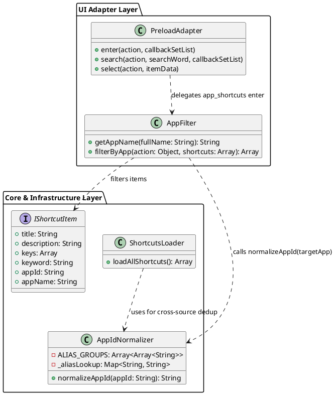
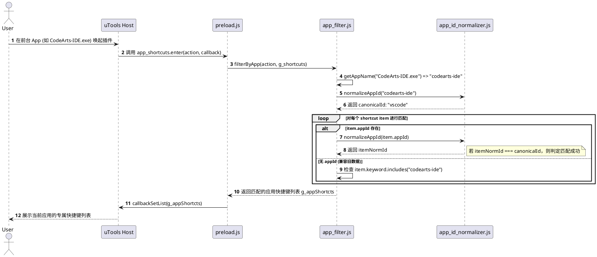

# SPEC-00017: 基于别名规范化的窗口应用快捷键匹配重构

## 1. 功能目标与背景

### 1.1 现状与问题分析
1. **匹配方式单一脆弱**：当前在应用前台唤出插件时，`app_filter.js` 仅使用 `item.keyword.indexOf(app) !== -1` 对应用名进行纯子字符串搜索。
2. **多源演进带来的数据割裂**：随着 SPEC-00010（统一 Schema）、SPEC-00012（内置 CheatSheet 支持）的落地，高优先级的 CheatSheet JSON（`cheatsheet_builtin`）覆盖了原有硬编码 JS（`shortcuts/vscode/shortcuts.js`）。然而 JSON 中的 `keyword` 仅包含应用的标准名称（如 `"visual studio code ..."`），并不包含衍生别名（如 `CodeArts-IDE.exe` 对应的 `codearts-ide`、`Code.exe` 对应的 `code` 等）。
3. **别名规范化配置未打通窗口匹配**：`ALIAS_GROUPS` 目前仅在 `ShortcutsLoader` 加载时用于多数据源的冲突去重与覆盖，未介入 `app_filter.js` 的窗口匹配逻辑。导致用户在 `ALIAS_GROUPS` 中配置了应用别名（如将 `CodeArts-IDE` 映射为 `vscode`）后，在 `CodeArts-IDE` 窗口下唤出插件依然无法匹配到 VSCode 的快捷键。

### 1.2 核心目标
- **统一别名解析与匹配机制**：将 `app_id_normalizer.js` 的 `normalizeAppId` 深度整合到 `app_filter.js` 中，形成“规范化 AppId 精确匹配优先 + Keyword 模糊搜索兜底”的双层匹配机制。
- **打通别名扩展能力**：支持任何在 `ALIAS_GROUPS` 中配置的别名（如 `codearts-ide` 映射到 `vscode`），使匹配到的前台应用能自动映射到标准应用快捷键集合，无论数据源是来自 CheatSheet JSON、用户自定义配置还是原生 JS。
- **扩展 VSCode / JetBrains 等常见应用别名组**：在 `ALIAS_GROUPS` 中补充 `codearts-ide`、`codeartside`、`codearts` 等衍生工具映射。
- **保障向后兼容**：对未声明 `appId` 的旧格式条目继续保持 `keyword` 包含匹配，确保平滑兼容。

### 1.3 非目标 (Non-Goals)
- 本次重构不修改 uTools 的底层窗口特征声明机制（`plugin.json` 中的 `match.app` 列表依然按需维护）。
- 本次重构不改变快捷键搜索框中针对快捷键标题、描述的即时过滤算法。

---

## 2. 用户操作流程 (User Flow)

```
+--------------------------------------------------------------------------+
| 用户在目标应用 (如 CodeArts IDE / VSCode / Chrome) 前台按下快捷键唤出插件      |
+--------------------------------------------------------------------------+
                                    |
                                    v
+--------------------------------------------------------------------------+
| uTools 命中 `app_shortcuts` 特性，提取窗口应用名 (如 "CodeArts-IDE.exe")   |
| 并将 action 载荷传递给插件入口                                                |
+--------------------------------------------------------------------------+
                                    |
                                    v
+--------------------------------------------------------------------------+
| `app_filter.js` 提取应用名并调用 `normalizeAppId` 计算出标准 Canonical AppId|
| (例如 "CodeArts-IDE.exe" -> "codearts-ide" -> "vscode")                  |
+--------------------------------------------------------------------------+
                                    |
                                    v
+--------------------------------------------------------------------------+
| 过滤器遍历快捷键列表进行双层匹配：                                           |
| 1. 条目包含 appId: 若 normalizeAppId(item.appId) == "vscode"，判定命中       |
| 2. 兜底判定: 若 item.keyword 包含 "codearts-ide"，判定命中                    |
+--------------------------------------------------------------------------+
                                    |
                                    v
+--------------------------------------------------------------------------+
| 仅将命中当前应用的快捷键集合渲染至列表，支持用户后续在当前应用作用域下二次检索    |
+--------------------------------------------------------------------------+
```

---

## 3. 详细架构与逻辑设计

### 3.1 架构分层与类设计



### 3.2 交互时序设计



### 3.3 核心类与接口契约

#### 3.3.1 `src/infrastructure/app_id_normalizer.js` 扩展
扩展 `ALIAS_GROUPS` 别名映射组，确保衍生 IDE / 工具与标准 `appId` 对齐：
```javascript
const ALIAS_GROUPS = [
    ['vscode', 'visual-studio-code', 'visualstudiocode', 'codearts-ide', 'codeartside', 'codearts', 'vscode-huawei'],
    ['jet_brains', 'intellij-idea', 'jetbrains', 'idea'],
    ['google-chrome', 'googlechrome', 'chrome'],
    ['microsoft-excel', 'microsoftexcel', 'excel', 'office_excel'],
    ['microsoft-word', 'microsoftword', 'word', 'office_word'],
    ['microsoft-powerpoint', 'microsoftpowerpoint', 'powerpoint', 'office_ppt'],
    ['microsoft-onenote', 'microsoftonenote', 'onenote', 'office_onenote'],
    ['sublime-text', 'sublimetext'],
    ['navicat-premium', 'navicatpremium'],
    ['phpstorm', 'php-storm'],
    ['pycharm', 'py-charm'],
    ['webstorm', 'web-storm'],
    ['microsoft-visual-studio', 'microsoftvisualstudio', 'visualstudio'],
    ['foxit-reader', 'foxitpdfreader', 'foxit-pdf-reader'],
    ['margin-note', 'marginnote', 'marginnote3', 'marginnote4'],
    ['pdf-expert', 'pdfexpert']
];
```

#### 3.3.2 `src/adapter/app_filter.js` 匹配算法重构
提取并标准化前台 App 名称，优先按规范化 `appId` 对比，其次按 `keyword` 兜底：

```
ALGORITHM FilterShortcutsByApp(action, shortcuts)
  INPUT: action containing payload.app, list of shortcut items
  OUTPUT: filtered list of shortcut items

  rawAppName <- ExtractBaseName(action.payload.app).toLowerCase()
  targetNormId <- NormalizeAppId(rawAppName)

  result <- EMPTY_LIST

  FOR EACH item IN shortcuts DO
    isMatched <- FALSE
    
    // 规则 1: 标准化 AppId 精确匹配
    IF item.appId IS NOT EMPTY THEN
      itemNormId <- NormalizeAppId(item.appId)
      IF itemNormId = targetNormId AND targetNormId != "" THEN
        isMatched <- TRUE
      END IF
    END IF

    // 规则 2: Keyword 包含模糊匹配 (兜底与兼容)
    IF NOT isMatched AND item.keyword IS NOT EMPTY THEN
      IF item.keyword CONTAINS rawAppName THEN
        isMatched <- TRUE
      END IF
    END IF

    IF isMatched THEN
      APPEND item TO result
    END IF
  END FOR

  SORT result BY hitTimeStamp DESCENDING
  RETURN result
END ALGORITHM
```

---

## 4. 测试用例设计 (Test Design)

| 用例编号 | 测试类型 | 测试场景与输入 | 预期结果 |
|---------|---------|--------------|----------|
| **TC-001** | 单元测试 | 输入 `action.payload.app = "CodeArts-IDE.exe"`，快捷键数据包含 `appId: "visual-studio-code"` | 成功匹配并返回 VSCode 的快捷键列表 |
| **TC-002** | 单元测试 | 输入 `action.payload.app = "Visual Studio Code.app"`，快捷键数据包含 `appId: "visual-studio-code"` | 成功匹配并返回 VSCode 的快捷键列表 |
| **TC-003** | 单元测试 | 输入 `action.payload.app = "Code.exe"`，快捷键数据包含 `appId: "visual-studio-code"` | 成功匹配并返回 VSCode 的快捷键列表 |
| **TC-004** | 单元测试 | 输入 `action.payload.app = "MarginNote 4.app"`，快捷键数据包含 `appId: "margin-note"` | 成功匹配并返回 MarginNote 的快捷键列表 |
| **TC-005** | 单元测试 | 快捷键条目无 `appId`，但 `keyword = "my-custom-tool 打开"`，输入 `action.payload.app = "my-custom-tool.exe"` | 触发 keyword 兜底匹配，成功返回该条目 |
| **TC-006** | 单元测试 | 输入未收录应用 `action.payload.app = "unknown_app.exe"` | 返回空数组，不发生异常或崩溃 |
| **TC-007** | 集成测试 | 启动 `ShortcutsLoader`，验证 `CheatsheetBuiltinLoader` 加载的数据在经过 `app_filter` 过滤时对 `CodeArts-IDE.exe` 的完整端到端匹配 | 列表正确返回，且不包含其他应用的快捷键 |
