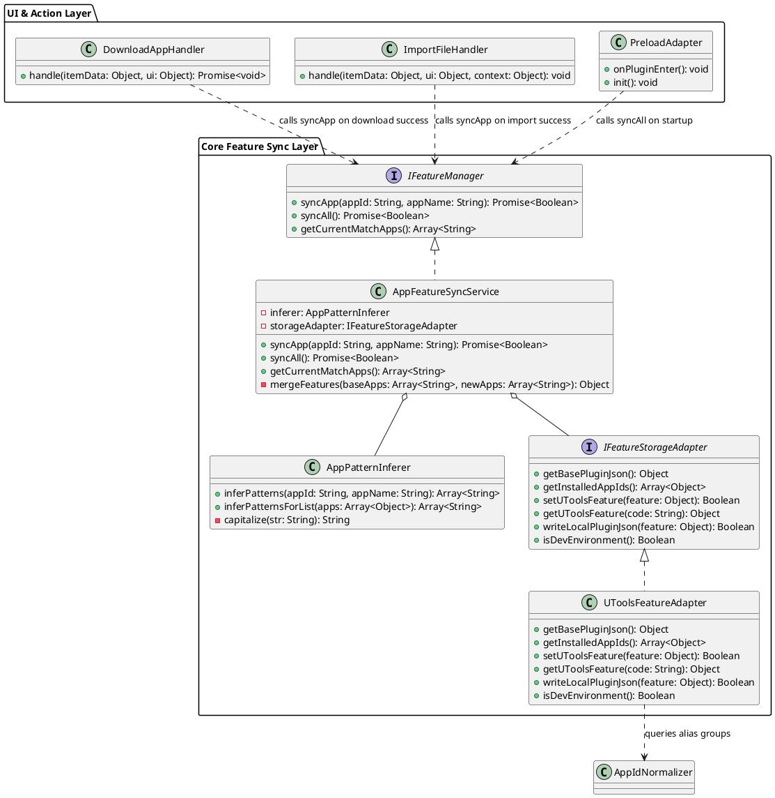
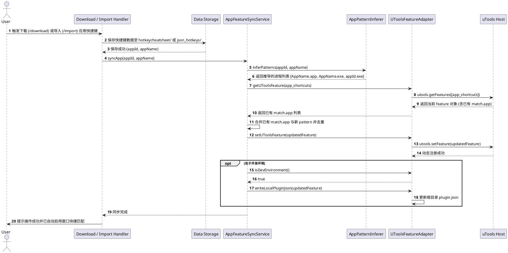
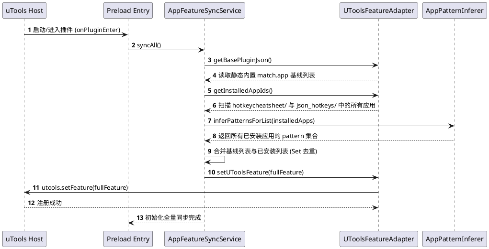

# SPEC-00018: 基于动态 Feature 注入的应用快捷键窗口匹配

## 1. 功能目标与背景

### 1.1 现状与问题分析
1. **静态匹配列表限制**：当前 `plugin.json` 中的 `app_shortcuts` 特性通过静态硬编码的 `match.app` 数组声明支持的宿主窗口进程（如 `"Google Chrome.app"`, `"Code.exe"` 等）。
2. **下载与导入新应用无法唤出**：当用户从外部平台下载（`/download` 命令，如 `hotkeycheatsheet.com`）或本地导入新应用快捷键（`/import` 命令，如 Defkey 文本文件、自定义 JSON）后，由于该应用不在打包时预设的 `match.app` 列表中，用户在该应用前台唤出 uTools 时，uTools 无法将“查找应用快捷键”这一 Feature 推荐并匹配给用户。
3. **打包插件的运行时限制**：在插件正式打包（`.upx`）并在用户端安装后，插件包位于只读或缓存目录，无法也不应通过直接修改本地 `plugin.json` 磁盘文件来更新匹配规则。并且 uTools 宿主不会监听 `plugin.json` 文件的磁盘变动。
4. **官方动态特性支持**：uTools 官方提供了 `utools.setFeature(feature)` 与 `utools.getFeatures([codes])` 运行时 API，支持在插件运行期动态注入、覆盖和更新 Feature 及其 `match.app` 规则，且由 uTools 宿主在用户数据层持久化。

### 1.2 核心目标
- **下载与导入后即时生效 (Real-time Dynamic Registration)**：用户在通过 `/download` 下载或 `/import` 导入任一应用的快捷键后，系统自动推导该应用在各平台的窗口进程名（如 `.app`, `.exe`），并即时通过 `utools.setFeature` 将新规则注入到 `app_shortcuts` 特性中，无需重启插件即可在前台窗口命中。
- **冷启动全量聚合同步 (Cold Start Aggregation & Sync)**：在插件初始化（`preload.js` 加载）阶段，扫描本地已下载（`hotkeycheatsheet/`）及已导入（`json_hotkeys/`）的所有快捷键文件，与内置基线 `match.app` 列表进行去重聚合，执行幂等同步，确保多设备或重启后窗口匹配规则始终完整有效。
- **跨平台应用标识智能推导 (Smart Pattern Inference)**：根据 `appId`、`appName` 并联动 `ALIAS_GROUPS` 别名映射，自动生成符合规范的 macOS（`*.app`）和 Windows（`*.exe`）进程名。
- **开发环境可选回写 (Dev Env File Sync)**：在本地源码开发环境下，若检测到根目录存在可写的 `plugin.json`，同步将新增的应用更新至 `plugin.json` 文件中，便于开发者管理与源码固化。

### 1.3 非目标 (Non-Goals)
- **手动/自定义配置应用进程名称**：由于导入文件来源多样（如各类自定义文本、Defkey 等），自动推导难以 100% 穷尽所有小众或特殊命名进程。**本需求不包含手动设置/修改应用关联进程名称的交互界面与逻辑**，该能力后续将规划专门的需求（如应用快捷键管理/进程别名配置）独立实现。
- 本次改造不改变已存在的全局关键词触发命令（`shortcuts` 命令下的 `快捷键`, `hk`, `hotkey` 等）。
- 本次改造不修改 `app_filter.js` 内的内存级匹配算法（SPEC-00017 已完成规范化 AppId 精确匹配）。

---

## 2. 用户操作流程 (User Flow)

```
+-----------------------------------------------------------------------------------+
| 途径 A: 用户在插件内通过 /download 下载外部应用 (例如 "Figma" / "Cursor")           |
| 途径 B: 用户在插件内通过 /import 导入本地 Defkey / JSON 文件 (例如 "One Commander") |
+-----------------------------------------------------------------------------------+
                                        |
                                        v
+-----------------------------------------------------------------------------------+
| Handler (DownloadAppHandler / ImportFileHandler) 保存 JSON 至本地存储目录           |
| (hotkeycheatsheet/*.json 或 json_hotkeys/*.json)                                   |
+-----------------------------------------------------------------------------------+
                                        |
                                        v
+-----------------------------------------------------------------------------------+
| AppFeatureSyncService 触发增量更新：                                               |
| 1. AppPatternInferer 推导应用进程名 (如 "Figma.app", "Figma.exe", "figma.exe")     |
| 2. 从 uTools 获取当前 app_shortcuts feature 或读取基线配置                         |
| 3. 合并新推导的应用名并去重                                                         |
| 4. 调用 utools.setFeature(updatedFeature) 动态注入 uTools 宿主                      |
| 5. (开发环境) 同步将新应用名写入根目录 plugin.json                                    |
+-----------------------------------------------------------------------------------+
                                        |
                                        v
+-----------------------------------------------------------------------------------+
| 用户切换至目标应用前台，按下 uTools 全局快捷键唤出                                    |
| -> uTools 成功命中 app_shortcuts 特性并展示 "查找应用快捷键"                         |
+-----------------------------------------------------------------------------------+
```

---

## 3. 详细架构与逻辑设计

### 3.1 核心设计原则 (HARD_GATE)
- **单一职责原则 (SRP)**：将进程名推导（`AppPatternInferer`）与 Feature 动态注册同步（`AppFeatureSyncService`）解耦。
- **依赖倒置与环境解耦 (DIP)**：通过抽象适配器层封装 `utools.setFeature` 与本地文件系统操作，确保单元测试可在纯 Node.js/Jest 环境下完整运行。
- **幂等性保障 (Idempotence)**：冷启动同步与增量注入均为幂等操作，多次执行不会产生重复项或破坏已有规则。

### 3.2 软件架构图与类图 (PlantUML)



### 3.3 交互时序图 (PlantUML)

#### 3.3.1 下载/导入应用快捷键并动态更新 Feature 时序



#### 3.3.2 插件冷启动全量聚合同步时序



### 3.4 核心类与接口契约

#### 3.4.1 `AppPatternInferer` (应用匹配模式推导器)
- **职责**：基于自动化规则（Best-Effort）将外部应用的 `appId` 与 `appName` 转换为跨平台进程识别标识。
- **说明**：自动推导能够覆盖绝大多数标准命名的应用。针对部分特殊命名的导入文件，后续将通过独立需求提供用户手动设置/编辑关联进程名称的功能，本模块专注于规则化自动推导。
- **推导规则**：
  1. **macOS 规则**：
     - 若 `appName` 非空：`${appName}.app`（例如 `Cursor.app`、`Google Chrome.app`）。
     - 若 `appId` 存在且不同于 `appName`：`${capitalize(appId)}.app`。
  2. **Windows 规则**：
     - `${appName}.exe`（例如 `Cursor.exe`）。
     - `${appId}.exe`（例如 `cursor.exe`）。
     - `${appId.toUpperCase()}.EXE`（兼容大写进程，如 `EXCEL.EXE`）。
  3. **别名关联规则 (Normalizer Integration)**：
     - 从 `ALIAS_GROUPS` 查找该应用已知的所有别名组。
     - 若命中别名（例如 `vscode` 别名含 `codearts-ide`），同时推导 `${alias}.exe` 与 `${alias}.app`。

```
ALGORITHM InferPatterns(appId, appName)
  INPUT: appId (String), appName (String)
  OUTPUT: list of match.app strings (Set)

  patterns <- EMPTY_SET

  cleanName <- TRIM(appName)
  cleanId <- TRIM(appId)

  // 1. macOS 规则
  IF cleanName IS NOT EMPTY THEN
    ADD cleanName + ".app" TO patterns
  END IF
  IF cleanId IS NOT EMPTY THEN
    ADD CapitalizeWords(cleanId) + ".app" TO patterns
  END IF

  // 2. Windows 规则
  IF cleanName IS NOT EMPTY THEN
    ADD cleanName + ".exe" TO patterns
  END IF
  IF cleanId IS NOT EMPTY THEN
    ADD cleanId + ".exe" TO patterns
    ADD cleanId.toUpperCase() + ".EXE" TO patterns
  END IF

  // 3. 别名拓展 (从 ALIAS_GROUPS 提取)
  aliases <- GetAliasesForApp(cleanId)
  FOR EACH alias IN aliases DO
    ADD alias + ".exe" TO patterns
    ADD alias + ".app" TO patterns
  END FOR

  RETURN Array.from(patterns)
END ALGORITHM
```

#### 3.4.2 `AppFeatureSyncService` (Feature 动态同步服务)
- **Feature Code**：固定为 `"app_shortcuts"`。
- **Cmd 定义结构**：
  ```json
  {
    "code": "app_shortcuts",
    "explain": "查找应用快捷键",
    "platform": ["darwin", "win32"],
    "cmds": [
      {
        "type": "window",
        "label": "查找应用快捷键",
        "match": {
          "app": [
            "Microsoft Word.app",
            "..."
          ]
        }
      }
    ]
  }
  ```
- **同步方法契约**：
  - `syncApp(appId, appName)`: 增量提取并合并，调用 `utools.setFeature`。
  - `syncAll()`: 全量聚合并同步（同时扫描 `hotkeycheatsheet/` 和 `json_hotkeys/`），保证幂等。

#### 3.4.3 `UToolsFeatureAdapter` (存储与环境适配器)
- 封装 `window.utools.setFeature`、`window.utools.getFeatures`、`utools.dbStorage`。
- 提供安全防护：当在非 uTools 运行时环境（如 Node.js 单元测试）下，优雅降级或使用 Mock，不抛出全局异常。

---

## 4. 测试用例设计 (Test Design)

| 用例编号 | 模块 | 测试类型 | 测试场景与输入 | 预期结果 |
| :--- | :--- | :--- | :--- | :--- |
| **TC-001** | `AppPatternInferer` | 单元测试 | 输入 `appId: "cursor"`, `appName: "Cursor"` | 包含 `"Cursor.app"`, `"Cursor.exe"`, `"cursor.exe"` |
| **TC-002** | `AppPatternInferer` | 单元测试 | 输入 `appId: "visual-studio-code"`, `appName: "Visual Studio Code"` | 包含 `"Visual Studio Code.app"`, `"Code.exe"`, `"codearts-ide.exe"` 等别名 |
| **TC-003** | `AppPatternInferer` | 单元测试 | 输入含非法字符或空输入 `appId: ""`, `appName: null` | 返回空数组，不发生异常或崩溃 |
| **TC-004** | `AppFeatureSyncService` | 单元测试 | 初始 `match.app` 包含 5 个应用，调用 `syncApp("figma", "Figma")` | 生成合法的 Feature 对象，`match.app` 增加 Figma 对应的 pattern 且去重，成功调用 `setFeature` |
| **TC-005** | `AppFeatureSyncService` | 单元测试 | 重复调用 `syncApp("figma", "Figma")` 多次 | `match.app` 长度不变，保证严格幂等 |
| **TC-006** | `AppFeatureSyncService` | 单元测试 | 本地同时存在 `hotkeycheatsheet/` 和 `json_hotkeys/` 目录中的多个应用配置文件，执行 `syncAll()` | 扫描两处目录的所有应用，与 `plugin.json` 基线合并，生成完整且去重的 `match.app` 列表 |
| **TC-007** | `DownloadAppHandler` | 集成测试 | 模拟从 hotkeycheatsheet 成功下载某应用快捷键 | 成功触发 `syncApp`，并向 UI 输出成功提示 |
| **TC-008** | `ImportFileHandler` | 集成测试 | 模拟通过 Defkey 文件成功导入某应用快捷键 | 成功保存至 `json_hotkeys/` 并触发 `syncApp` 动态注入 Feature |
| **TC-009** | `PreloadAdapter` | 集成测试 | 插件启动初始化时 | 触发 `syncAll`，uTools 运行时注册最新全量 Feature |
