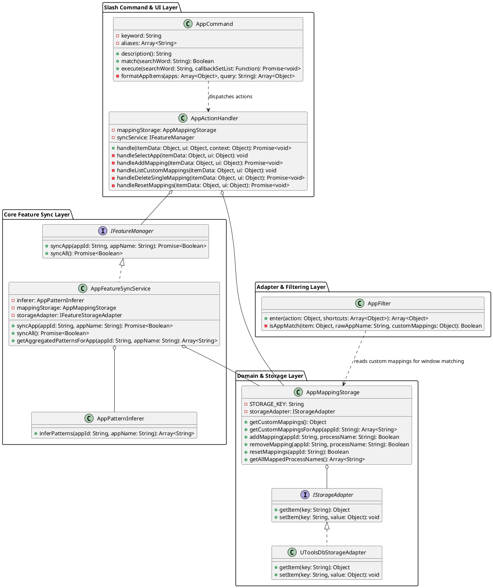
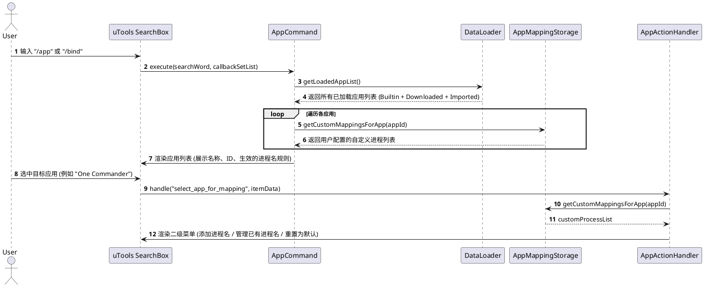
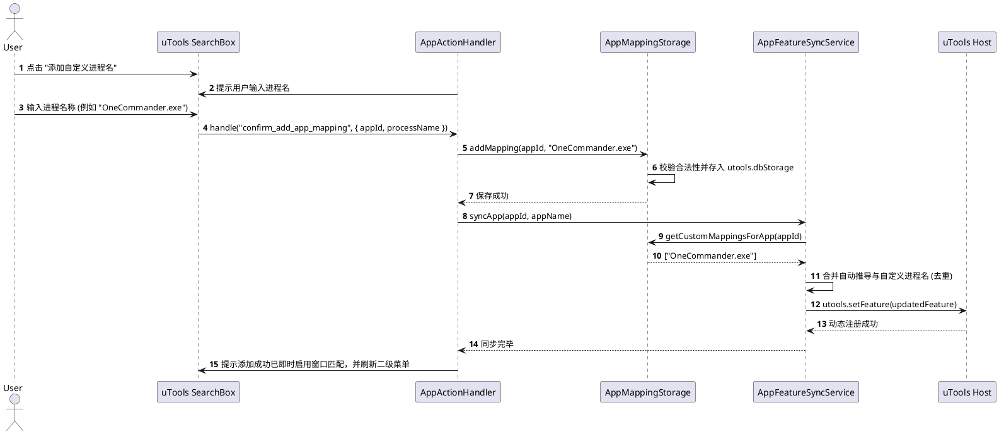
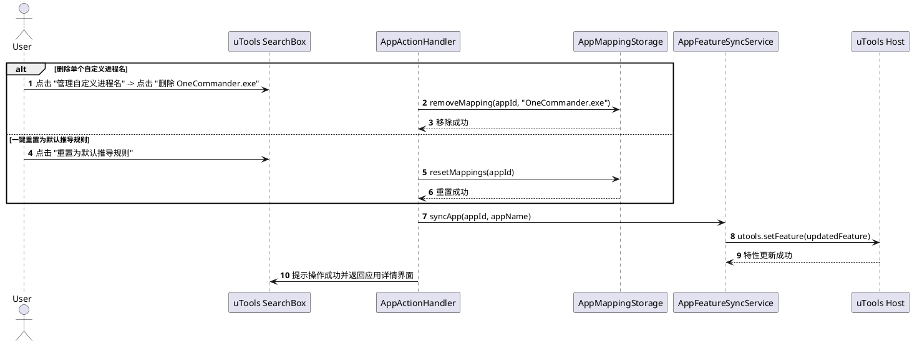

# SPEC-00019: 设置快捷键对应应用进程名称的斜线命令 (/app)

## 1. 功能目标与背景

### 1.1 现状与问题分析
1. **自动推导覆盖局限**：在 SPEC-00018 中引入了 `AppPatternInferer` 与 `AppFeatureSyncService`，实现了基于 `appId` 与 `appName` 的自动化跨平台进程名推导（如 `AppName.app`, `AppName.exe`）。然而，许多小众软件、绿色版软件或特定版本（例如 `One Commander` 在某些系统上实际进程名为 `OneCommander.exe`，`Visual Studio Code` 内部名为 `Code.exe` / `codearts-ide.exe`，部分游戏/工具为缩写或特殊命名）无法被标准命名规则 100% 穷尽。
2. **下载与导入后匹配失效**：用户通过 `/download`（下载热门快捷键）或 `/import`（导入本地 Defkey / JSON）添加快捷键后，若实际运行的窗口进程名与自动推导不一致，切到该应用窗口时 uTools 无法自动弹出并推荐快捷键，导致“能搜到但窗口无法自动识别”。
3. **缺乏可视化管理与配置入口**：用户目前无法直观查看某一快捷键集已绑定的所有进程名称，也无法手动为快捷键集追加或修正进程名。

### 1.2 核心目标
- **新增 `/app`（别名 `/bind`）斜线命令**：提供专门用于管理快捷键与操作系统应用进程匹配关系的命令入口。
- **直观的可视化管理流程**：
  - 支持检索已加载的所有快捷键应用（内置、下载、导入）。
  - 显示每个应用当前已匹配的进程规则（含自动推导与自定义项）。
  - 支持**添加/追加自定义进程名**、**查看/删除自定义进程名**、**一键重置为默认规则**。
- **非侵入增量合并 (Merge)**：自定义进程名作为增量规则与系统自动推导规则合并，不破坏原有基础推导能力。
- **即时动态注册 (Real-time Feature Sync)**：用户完成进程名添加或修改后，立即调用 `AppFeatureSyncService` 与 `utools.setFeature` 动态更新 uTools 宿主的 `match.app` 规则，无需重启插件或应用即可在前台窗口立即生效。
- **统一 DB 存储持久化**：用户配置持久化至 `utools.dbStorage`，与具体 JSON 数据源解耦，保证插件升级与快捷键重新下载时配置不丢失。

### 1.3 非目标 (Non-Goals)
- 本次改造不修改基础快捷键搜索主流程。
- 本次改造不涉及跨设备云端账户同步配置（后续统一规划云同步能力）。

---

## 2. 用户操作流程 (User Flow)

```
+---------------------------------------------------------------------------------------+
| 步骤 1: 用户在 uTools 搜索框中输入 "/app" 或 "/bind"                                    |
| -> 列表展示本地已加载的所有应用 (支持拼音/英文实时搜索过滤)                                |
| -> 每一项显示: 应用名称、ID、来源、当前已生效的进程名 (如 "One Commander.exe, OneCommander.exe")|
+---------------------------------------------------------------------------------------+
                                           |
                                           v
+---------------------------------------------------------------------------------------+
| 步骤 2: 用户选中目标应用 (例如 "One Commander")                                         |
| -> 进入二级操作菜单:                                                                  |
|    1. ➕ 添加自定义进程名 (如输入 "OneCommander.exe" 或 "one_commander.app")            |
|    2. 📋 管理/删除自定义进程名 (列出已添加的手动进程名，点击即可删除)                     |
|    3. 🔄 重置为默认推导规则 (清除该应用的所有自定义进程绑定)                               |
+---------------------------------------------------------------------------------------+
                                           |
                                           v
+---------------------------------------------------------------------------------------+
| 步骤 3: 用户执行操作 (例如添加 "OneCommander.exe")                                    |
| 1. AppMappingStorage 保存至 utools.dbStorage('custom_app_process_mappings')           |
| 2. AppFeatureSyncService 重新聚合所有进程名并调用 utools.setFeature 动态注入 uTools 宿主  |
| 3. UI 弹出操作成功提示，并刷新展示最新的生效进程名列表                                  |
+---------------------------------------------------------------------------------------+
                                           |
                                           v
+---------------------------------------------------------------------------------------+
| 步骤 4: 用户切换至 One Commander 应用窗口，呼出 uTools                                   |
| -> 成功命中 app_shortcuts 特性并自动过滤出 One Commander 快捷键                         |
+---------------------------------------------------------------------------------------+
```

---

## 3. 详细架构与逻辑设计

### 3.1 核心设计原则 (HARD_GATE)
- **单一职责原则 (SRP)**：
  - `AppCommand` 仅负责 `/app` 斜线命令的输入解析与应用列表展示。
  - `AppActionHandler` 负责处理子操作项的分发（添加、删除、重置）。
  - `AppMappingStorage` 专注于自定义进程映射在 `utools.dbStorage` 的 CRUD。
  - `AppFeatureSyncService` 统一协调自动推导、自定义映射与 uTools 动态 Feature 注入。
- **开闭原则 (OCP)**：通过命令分发机制与 Action Registry 扩展新的斜线命令与交互动作，无需侵入 `preload.js` 核心逻辑。
- **高内聚低耦合 (High Cohesion & Low Coupling)**：存储层与 UI 层完全解耦，提供标准接口供 `app_filter.js` 与 `AppFeatureSyncService` 复用。

### 3.2 软件架构图与类图 (PlantUML)



### 3.3 交互时序图 (PlantUML)

#### 3.3.1 输入 /app 检索应用并进入二级配置菜单时序



#### 3.3.2 添加自定义进程名与即时生效时序



#### 3.3.3 删除自定义进程名与一键重置时序



---

## 4. 核心类与接口契约

### 4.1 `AppCommand`
- **文件路径**: `src/core/slash_commands/app.js`
- **关键字**: `/app`，支持别名 `/bind`
- **方法契约**:
  - `match(searchWord: String): Boolean`: 匹配 `/app` 或 `/bind` 开头的查询词。
  - `execute(searchWord: String, callbackSetList: Function): Promise<void>`:
    1. 获取 `getLoadedAppList()`。
    2. 支持按应用名称、ID 过滤。
    3. 获取每个应用当前的全部匹配进程名（自动推导 + 自定义映射）。
    4. 渲染为带有明确状态标识的列表项。

### 4.2 `AppActionHandler`
- **文件路径**: `src/core/action_handlers/app_action_handler.js`
- **支持的 Action Types**:
  1. `select_app_for_mapping`: 展示目标应用的配置详情与二级操作选项。
  2. `prompt_add_app_mapping`: 引导添加自定义进程名。
  3. `confirm_add_app_mapping`: 写入存储并触发同步。
  4. `list_custom_app_mappings`: 列出该应用的所有手动添加项（带删除按钮）。
  5. `delete_single_app_mapping`: 删除单个手动添加项并触发同步。
  6. `reset_app_mappings`: 清空该应用的所有手动添加项并触发同步。

### 4.3 `AppMappingStorage`
- **文件路径**: `src/infrastructure/app_mapping_storage.js`
- **存储键名**: `custom_app_process_mappings`
- **数据结构**:
  ```json
  {
    "one-commander": [
      "OneCommander.exe",
      "OneCommander.app"
    ],
    "figma": [
      "FigmaBeta.exe"
    ]
  }
  ```
- **核心方法**:
  - `getCustomMappings(): Object`: 获取全量自定义映射字典。
  - `getCustomMappingsForApp(appId: String): Array<String>`: 获取指定应用自定义进程列表。
  - `addMapping(appId: String, processName: String): Boolean`: 添加进程名（自动修剪空格、去重、合法性校验）。
  - `removeMapping(appId: String, processName: String): Boolean`: 移除指定进程名。
  - `resetMappings(appId: String): Boolean`: 重置指定应用。
  - `getAllMappedProcessNames(): Array<String>`: 获取所有已配置的自定义进程名列表。

### 4.4 `AppFeatureSyncService` 联动契约扩展
- 在聚合应用的匹配规则时，将自定义映射与自动推导结果合并：
  ```
  AggregatedPatterns(appId, appName) = Set(
      AppPatternInferer.inferPatterns(appId, appName)
      ∪ AppMappingStorage.getCustomMappingsForApp(appId)
  )
  ```

### 4.5 `app_filter.js` 内存匹配规则增强
在 `app_filter.js` 执行前台窗口匹配时，增加第三重判定规则：
1. **规则 1**：`normalizeAppId(item.appId) === normalizeAppId(rawAppName)`（标准 ID 匹配）。
2. **规则 2**：用户自定义映射判定：若 `rawAppName` 存在于 `AppMappingStorage.getCustomMappingsForApp(item.appId)` 对应的格式化名称中，判定匹配。
3. **规则 3**：`item.keyword` 模糊包含匹配（历史兜底兼容）。

---

## 5. 核心伪代码 (Pseudocode)

```
ALGORITHM HandleAddAppMapping(appId, appName, inputProcessName)
  INPUT: appId (String), appName (String), inputProcessName (String)
  OUTPUT: Success (Boolean)

  cleanProcessName <- TRIM(inputProcessName)
  IF cleanProcessName IS EMPTY THEN
    RETURN FALSE
  END IF

  // 1. 规范化扩展名 (可选自动补全或直接保留用户输入)
  // 2. 存入持久化存储
  isSaved <- AppMappingStorage.addMapping(appId, cleanProcessName)
  IF NOT isSaved THEN
    RETURN FALSE
  END IF

  // 3. 动态注入到 uTools 宿主 Feature
  AppFeatureSyncService.syncApp(appId, appName)

  RETURN TRUE
END ALGORITHM
```

---

## 6. 测试用例设计 (Test Design)

| 用例编号 | 模块 | 测试类型 | 测试场景与输入 | 预期结果 |
| :--- | :--- | :--- | :--- | :--- |
| **TC-001** | `AppCommand` | 单元测试 | 输入 `/app` 或 `/bind` | 正确匹配并返回所有已加载应用的列表项 |
| **TC-002** | `AppCommand` | 单元测试 | 输入 `/app figma` 进行过滤 | 仅返回名称或 ID 包含 `figma` 的应用列表 |
| **TC-003** | `AppMappingStorage` | 单元测试 | 对 `appId: "one-commander"` 调用 `addMapping(..., "OneCommander.exe")` | 正确写入存储，`getCustomMappingsForApp` 返回 `["OneCommander.exe"]` |
| **TC-004** | `AppMappingStorage` | 单元测试 | 重复添加相同进程名 `OneCommander.exe` | 保持唯一性去重，不重复增加 |
| **TC-005** | `AppMappingStorage` | 单元测试 | 调用 `removeMapping("one-commander", "OneCommander.exe")` | 成功从列表中移除该项 |
| **TC-006** | `AppMappingStorage` | 单元测试 | 调用 `resetMappings("one-commander")` | 清空该应用的所有自定义配置 |
| **TC-007** | `AppFeatureSyncService` | 集成测试 | 某应用存在默认推导规则与自定义规则 `["Custom.exe"]`，执行 `syncApp()` | 生成的 `match.app` 集合包含两者的并集，成功调用 `utools.setFeature` |
| **TC-008** | `app_filter.js` | 单元测试 | 当前前台进程为 `OneCommander.exe`，`one-commander` 存在该自定义映射 | `app_filter` 正确过滤出 One Commander 的快捷键 |
| **TC-009** | `AppActionHandler` | 集成测试 | 用户在 UI 点击添加映射并确认 | 存储已更新，`utools.setFeature` 被调用，UI 收到成功回调与新列表 |
