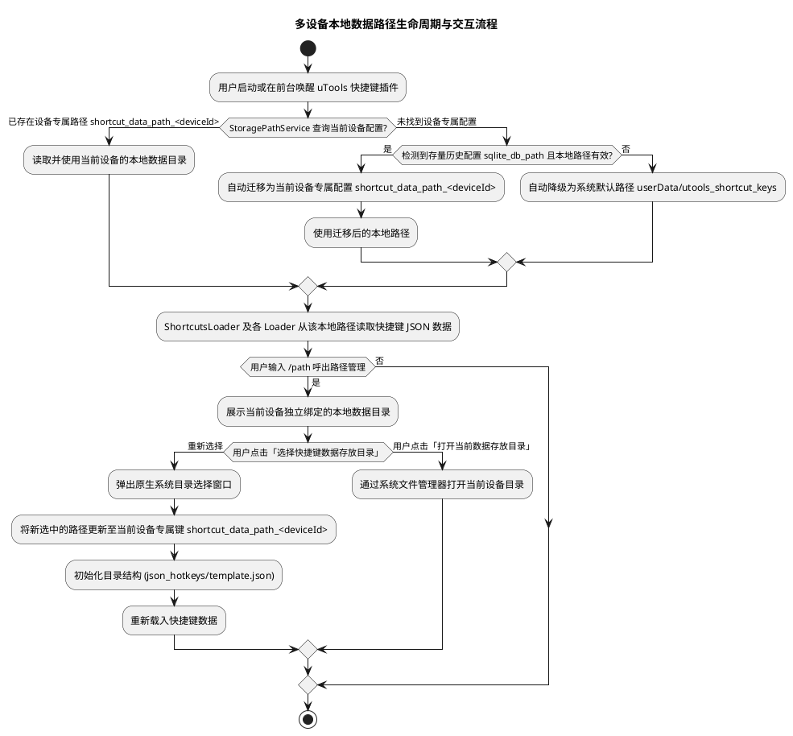
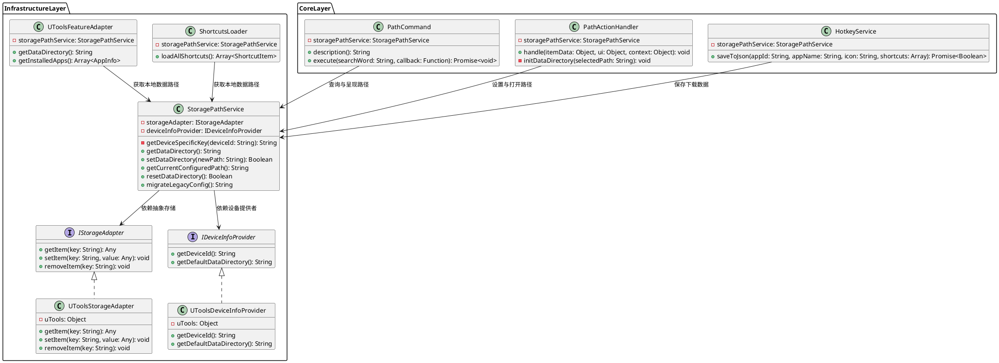
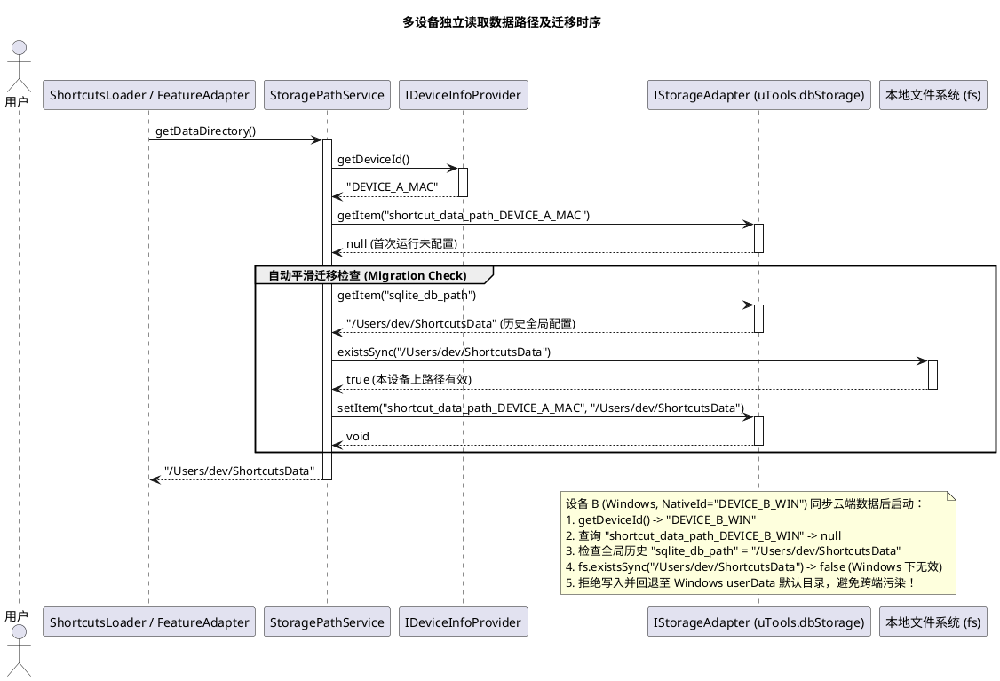
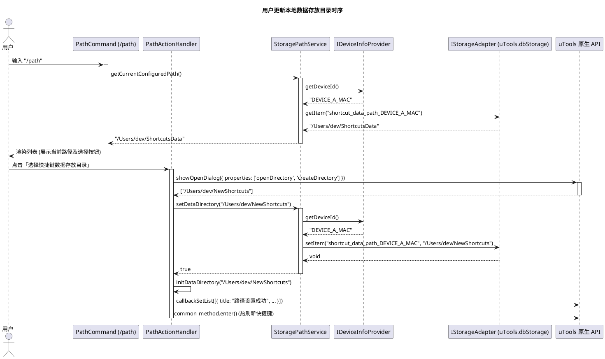

# SPEC-00022: 多设备快捷键数据目录隔离与本地存储路径管理设计文档

## 1. 功能目标与背景

### 1.1 核心目标
解决 uTools 在开启云端数据同步（VIP 会员功能）后，多台设备间因同步全局路径配置导致的文件路径污染与跨设备路径失效问题：
1. **设备级快捷键数据路径隔离 (Device-Isolated Storage Path)**：
   利用 uTools 设备唯一标识 (`utools.getNativeId()`) 对快捷键数据存储路径进行设备级隔离，采用 `shortcut_data_path_${deviceId}` 键名存储，确保 macOS、Windows、Linux 或不同用户名/盘符的设备拥有独立、互不干扰的本地数据目录配置。
2. **统一路径存储抽象服务 (`StoragePathService`)**：
   彻底重构并消除历史遗留的 `sqlite_db_path` 硬编码散落调用，收拢为统一的 `StoragePathService` 接口，严格遵循单一职责原则 (SRP) 与依赖倒置原则 (DIP)。
3. **无缝向前兼容与历史数据自动迁移 (Seamless Migration)**：
   自动检测并迁移存量的历史全局 `sqlite_db_path` 配置，当且仅当该路径在当前设备本地有效存在时完成向当前设备专属键 `shortcut_data_path_${deviceId}` 的无感迁移；在新设备未配置时，平滑降级至系统默认的 `userData/utools_shortcut_keys` 存储路径。

### 1.2 非目标 (Non-Goals)
- 本版本不涉及云端跨设备快捷键 JSON 内容的主动同步协议重构（快捷键内容同步仍由用户通过网盘、Git 或自定义目录自行管理）。
- 本版本不改变既有 `/path` 命令的交互界面形态（仍保留选择目录、打开目录、查看当前路径等基础交互）。
- 本版本不修改 `custom_app_process_mappings`（应用进程映射）等通用业务配置的跨设备同步机制。

---

## 2. 用户操作流程 (User Flow)



---

## 3. 详细架构与逻辑设计

### 3.1 核心设计原则 (HARD_GATE)
- **单一职责原则 (SRP)**：所有数据存储路径的读写、缺省值解析、多设备隔离计算、存量数据迁移逻辑全部封装在 `StoragePathService` 内部，其余业务模块一律不得直接拼接或访问底层 `dbStorage` 的路径 Key。
- **依赖倒置原则 (DIP)**：`StoragePathService` 依赖于抽象的 `IStorageAdapter` 与 `IDeviceInfoProvider`，便于在单元测试、CI 环境及 Electron 环境中灵活注入 Mock 对象。
- **高内聚低耦合**：将系统特殊路径（`userData`）获取与 Node.js 路径解析（`path.join`）从核心业务解耦，提供稳定的纯函数与服务类接口。

### 3.2 软件架构与类设计 (PlantUML)



### 3.3 交互时序图 (Interaction Sequence Diagrams)

#### 3.3.1 多设备独立读取与自动迁移时序图



#### 3.3.2 用户通过 `/path` 更改本地目录时序图



### 3.4 核心接口与数据结构设计

#### 3.4.1 数据存储 Key 规范
- **设备隔离 Key 规则 (推荐标准)**：
  ```
  shortcut_data_path_${deviceId}
  ```
  示例：`shortcut_data_path_a1b2c3d4e5f67890`
- **历史全局 Key (向下兼容只读)**：
  `sqlite_db_path`（保留只读检查用于单向向前迁移，写入时不再覆盖历史键）。

#### 3.4.2 核心伪代码设计 (Pseudocode)

```javascript
// StoragePathService 核心逻辑伪代码 (高内聚、无硬编码)
class StoragePathService {
    constructor(storageAdapter, deviceInfoProvider, fsModule) {
        this.storage = storageAdapter;
        this.device = deviceInfoProvider;
        this.fs = fsModule;
    }

    getDeviceSpecificKey() {
        const deviceId = this.device.getDeviceId() || 'default_device';
        return `shortcut_data_path_${deviceId}`;
    }

    getDataDirectory() {
        const key = this.getDeviceSpecificKey();
        const configured = this.storage.getItem(key);
        if (configured && typeof configured === 'string' && configured.trim() !== '') {
            return configured.trim();
        }

        // 尝试迁移历史遗留的 sqlite_db_path 配置
        const migrated = this.migrateLegacyConfig();
        if (migrated) {
            return migrated;
        }

        // 降级为系统默认路径
        return this.device.getDefaultDataDirectory();
    }

    setDataDirectory(newPath) {
        if (!newPath || typeof newPath !== 'string') return false;
        const cleanPath = newPath.trim();
        if (!cleanPath) return false;

        const key = this.getDeviceSpecificKey();
        this.storage.setItem(key, cleanPath);
        return true;
    }

    migrateLegacyConfig() {
        const legacyPath = this.storage.getItem('sqlite_db_path');
        if (legacyPath && typeof legacyPath === 'string' && legacyPath.trim() !== '') {
            const cleanLegacy = legacyPath.trim();
            // 校验历史路径在当前设备本地是否真实存在
            if (this.fs.existsSync(cleanLegacy)) {
                const key = this.getDeviceSpecificKey();
                this.storage.setItem(key, cleanLegacy);
                return cleanLegacy;
            }
        }
        return null;
    }
}
```

---

## 4. 测试用例设计 (Test Design)

| 用例 ID | 测试类别 | 输入条件 / 场景 | 预期结果 |
| :--- | :--- | :--- | :--- |
| **TC-PATH-01** | 设备隔离验证 | 设备 A (`id="devA"`) 设置路径为 `/path/on/devA`；设备 B (`id="devB"`) 设置路径为 `D:\path\on\devB` | 设备 A `getDataDirectory()` 返回 `/path/on/devA`；设备 B 返回 `D:\path\on\devB`，互不影响 |
| **TC-PATH-02** | 存量有效数据迁移 | 首次在新版本运行，设备存在历史全局 `sqlite_db_path="/local/valid/path"` 且本地磁盘存在该目录 | 自动写入 `shortcut_data_path_<deviceId>`，`getDataDirectory()` 返回该路径 |
| **TC-PATH-03** | 跨端失效数据防御 | 首次在 Windows (`id="win"`) 运行，云端同步了 Mac 的全局 `sqlite_db_path="/Users/mac/..."`，本地不存在该路径 | 迁移失败，不写入 Windows 设备专属 Key，回退到 Windows 的 `userData` 默认路径 |
| **TC-PATH-04** | 缺省与未设置降级 | 设备未设置任何配置，且无存量数据 | 自动返回 `path.join(userData, 'utools_shortcut_keys')` 默认目录 |
| **TC-PATH-05** | `/path` 设置持久化 | 用户调用 `setDataDirectory('/new/dir')` | 成功存入当前设备的 `shortcut_data_path_<deviceId>`，下次读取立即生效 |
| **TC-PATH-06** | 异常入参防御 | 调用 `setDataDirectory('')`、`setDataDirectory(null)`、`setDataDirectory(123)` | 返回 `false`，不修改现有配置 |
| **TC-PATH-07** | 全链路集成验证 | 修改存储路径后，`ShortcutsLoader`、`PathActionHandler`、`HotkeyService` 同步使用新路径读取与保存 | 所有模块均从统一的 `StoragePathService` 解析路径，行为一致 |

---
