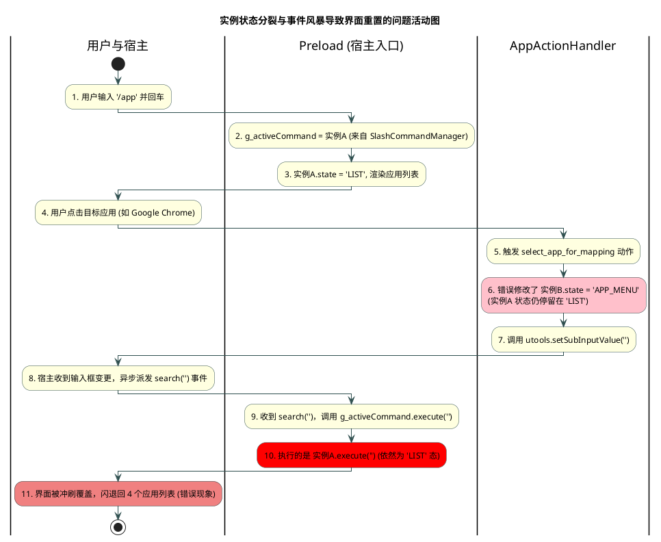
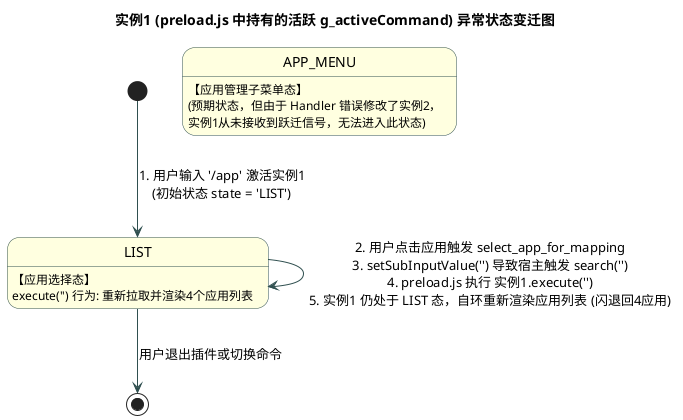
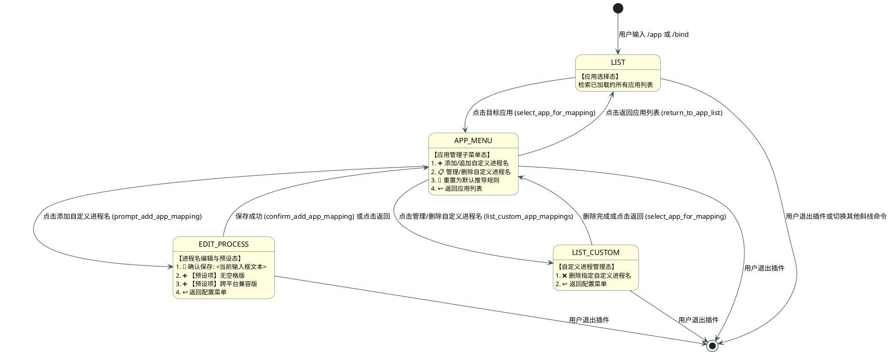
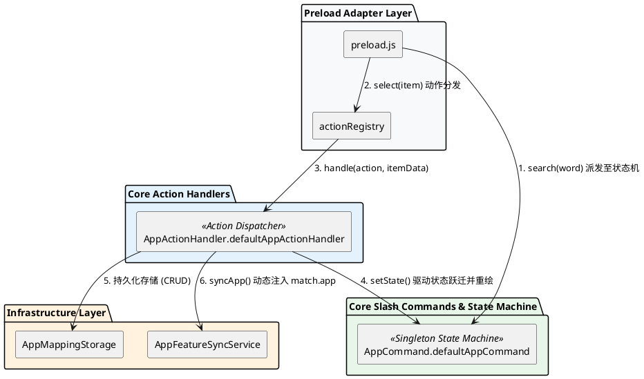
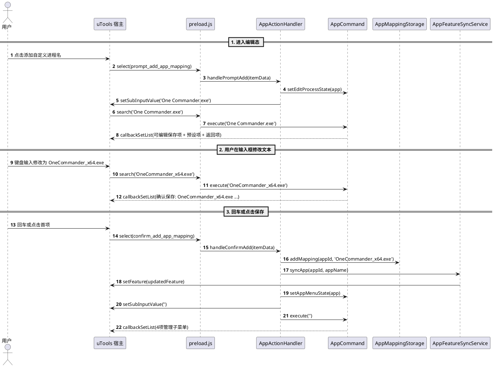

# SPEC-00020: 快捷键应用进程匹配交互状态机与文本编辑闭环设计

## 1. 功能目标与背景

### 1.1 现状与根本原因剖析 (Root Cause Analysis)

在 SPEC-00019 的实施过程中，出现点击应用后界面频繁闪烁并重置回初始 4 个应用列表（无法进入应用配置子菜单及文本编辑框）的问题。经全链路代码追踪，核心根因如下：

```
┌──────────────────────────────────────────────────────────────────────────────────────────────────┐
│                                       三大根因剖析                                               │
├──────────────────────────────────────────────────────────────────────────────────────────────────┤
│ 1. 实例状态分裂 (Instance Split):                                                                │
│    - slash_commands/index.js 注册了 new AppCommand() (实例 A)                                    │
│    - app_action_handler.js 内部引用了 defaultAppCommand (实例 B)                                 │
│    - 用户点击 /app 时，preload.js 的 g_activeCommand 指向 实例 A                                   │
│    - 用户点击应用时，AppActionHandler 将状态修改到了 实例 B，实例 A 状态仍然是 LIST                │
├──────────────────────────────────────────────────────────────────────────────────────────────────┤
│ 2. setSubInputValue 触发的搜索事件风暴 (Event Race Condition):                                   │
│    - 当调用 utools.setSubInputValue(val) 时，uTools 宿主会立即异步派发 search(val) 事件          │
│    - preload.js 收到 search 后调用 g_activeCommand (实例 A).execute(val)                         │
│    - 实例 A 处于 LIST 态且 query 不匹配，立即将列表冲刷覆盖为全局列表或空提示                     │
├──────────────────────────────────────────────────────────────────────────────────────────────────┤
│ 3. 缺乏显式的状态控制器 (State Machine):                                                         │
│    - 之前在 ActionHandler 与 Command 之间通过零散变量协作，缺乏单一真实状态源 (Single Source)    │
└──────────────────────────────────────────────────────────────────────────────────────────────────┘
```

#### 问题复现活动图 (Activity Diagram)



#### 问题复现状态机图 (State Machine Diagram for Instance 1)




### 1.2 核心目标
1. **全局唯一状态机单例 (Unified Command Singleton)**：
   - 统一 `AppCommand.defaultAppCommand` 为工程中唯一的应用匹配命令单例，彻底消除多实例状态割裂。
2. **确定性 4 状态机架构 (Deterministic State Machine)**：
   - `LIST`（应用列表检索态）
   - `APP_MENU`（应用专属 4 项管理子菜单态）
   - `EDIT_PROCESS`（进程名文本编辑与预设项选择态）
   - `LIST_CUSTOM`（自定义进程名列表与单项删除态）
3. **输入框实时编辑与预设项完美呈现 (Editable Wizard UX)**：
   - 进入 `EDIT_PROCESS` 态时，uTools 搜索框自动预置推荐进程名（如 `One Commander.exe` 或 `Microsoft Edge.app`）；
   - 列表首项展示 `💾 确认保存: <当前输入框内容>`（支持用户在搜索框中随意修改文本，按回车或点击直接保存）；
   - 列表第 2、3 项展示规范化预设项（无空格版、Mac/Win 跨平台版）；
   - 列表末项提供返回上级配置菜单按钮。
4. **生命周期与清理保护 (Lifecycle Guard)**：
   - 插件退出（`onPluginOut`）或进入其他命令时，自动重置状态机为 `LIST` 态，避免状态污染。

---

## 2. 状态机模型与用户交互流程 (State Machine & User Flow)

### 2.1 状态转移图 (PlantUML)



### 2.2 4 大交互界面原型 (UI Wireframes)

#### 界面 1: 应用选择态 (`LIST`)
```
[输入框]: /app chrome
--------------------------------------------------------------------------------
Google Chrome
  匹配进程: [Google Chrome.app, google-chrome.app 等共 20 个] · 点击配置关联进程
--------------------------------------------------------------------------------
Microsoft Edge
  匹配进程: [Microsoft Edge.app, Microsoft Edge.exe 等共 5 个] · 点击配置关联进程
```

#### 界面 2: 应用专属管理子菜单 (`APP_MENU`)
```
[输入框]: (空)
--------------------------------------------------------------------------------
➕ 添加/追加自定义进程名
  为 [One Commander] 添加操作系统进程名 (如 One Commander.exe, OneCommander.exe 等)
--------------------------------------------------------------------------------
📋 管理/删除自定义进程名 (1)
  已手动添加 1 个: OneCommanderCustom.exe
--------------------------------------------------------------------------------
🔄 重置为默认推导规则
  清除 [One Commander] 的所有手动配置项，恢复默认自动推导
--------------------------------------------------------------------------------
↩️ 返回应用列表
  返回 /app 快捷键应用管理主列表
```

#### 界面 3: 进程名文本编辑与预设项 (`EDIT_PROCESS`)
```
[输入框]: One Commander.exe (已预填，光标激活可编辑)
--------------------------------------------------------------------------------
💾 确认保存: One Commander.exe
  支持直接在上方输入框修改文本，回车或点击立即保存
--------------------------------------------------------------------------------
➕ 【预设项】OneCommander.exe (无空格版)
  点击立即将 [OneCommander.exe] 绑定至 [One Commander]
--------------------------------------------------------------------------------
➕ 【预设项】One Commander.app (Mac 兼容版)
  点击立即将 [One Commander.app] 绑定至 [One Commander]
--------------------------------------------------------------------------------
↩️ 返回 [One Commander] 配置菜单
  取消添加并返回
```

#### 界面 4: 自定义进程管理与删除 (`LIST_CUSTOM`)
```
[输入框]: (空)
--------------------------------------------------------------------------------
❌ 删除: OneCommanderCustom.exe
  点击移除该自定义进程匹配规则
--------------------------------------------------------------------------------
↩️ 返回 [One Commander] 配置菜单
  返回上级操作
```

---

## 3. 详细架构设计 (Detailed Architecture)

### 3.1 架构组件与依赖关系 (PlantUML)



### 3.2 文本编辑与即时同步时序图 (PlantUML)



---

## 4. 核心代码规范与实现细节

### 4.1 单例保证 (`src/core/slash_commands/index.js`)
必须直接注册 `defaultAppCommand`，严禁 `new AppCommand()` 产生分裂实例：
```javascript
const { defaultAppCommand } = require('./app.js');

function initCommands() {
  slashCommandManager.register(defaultAppCommand);
}
```

### 4.2 状态机控制 (`src/core/slash_commands/app.js`)
```javascript
class AppCommand {
  constructor(options = {}) {
    this.keyword = '/app';
    this.aliases = ['/bind'];
    this.state = 'LIST'; // 'LIST' | 'APP_MENU' | 'EDIT_PROCESS' | 'LIST_CUSTOM'
    this.currentApp = null;
  }

  reset() {
    this.state = 'LIST';
    this.currentApp = null;
  }

  setAppMenuState(app) {
    this.state = 'APP_MENU';
    this.currentApp = app;
  }

  setEditProcessState(app) {
    this.state = 'EDIT_PROCESS';
    this.currentApp = app;
  }

  setListCustomState(app) {
    this.state = 'LIST_CUSTOM';
    this.currentApp = app;
  }
}
```

---

## 5. 测试用例与验证矩阵 (Test Verification Matrix)

| 用例编号 | 测试场景 | 预期结果 |
|---|---|---|
| **TC-001** | `/app` 初始渲染与关键词过滤 (`LIST` 态) | 返回已加载的应用列表，支持 `/bind` 别名 |
| **TC-002** | 选中应用进入 `APP_MENU` 态 | 渲染 4 项管理子菜单，不发生状态回退 |
| **TC-003** | 点击添加进入 `EDIT_PROCESS` 态 | 渲染首项 `💾 确认保存: <defaultVal>`、2 项预设候选及返回按钮 |
| **TC-004** | 在 `EDIT_PROCESS` 态下修改输入框文本 | 首项动态更新为用户输入的最新字符串，保持可点击保存 |
| **TC-005** | 点击保存后状态流转 | 数据写入存储，触发 `syncApp` 动态注入，状态自动返回 `APP_MENU` 态 |
| **TC-006** | 进入 `LIST_CUSTOM` 态删除进程名 | 渲染已添加项，删除后即时从 DB 和 Feature 中同步移除 |
| **TC-007** | 重置与生命周期清理 | 点击重置恢复默认推导，退出插件时状态重置为 `LIST` |
