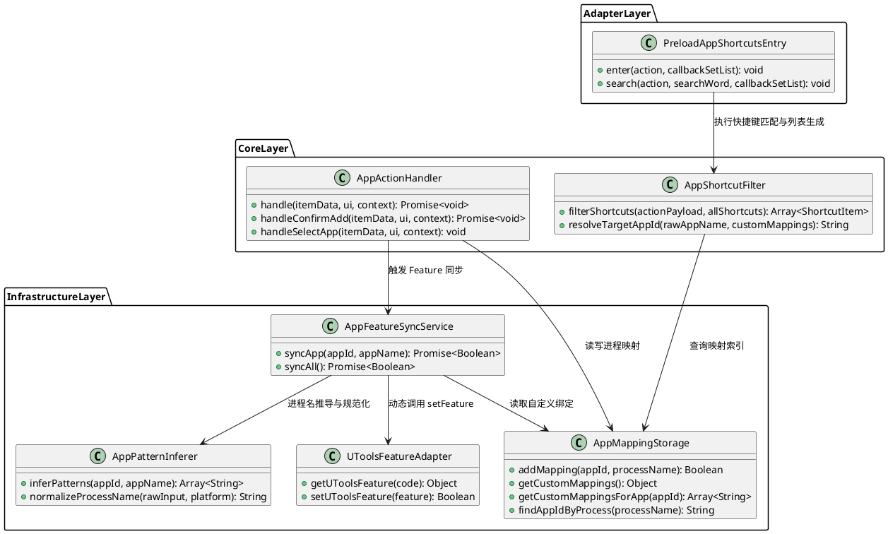
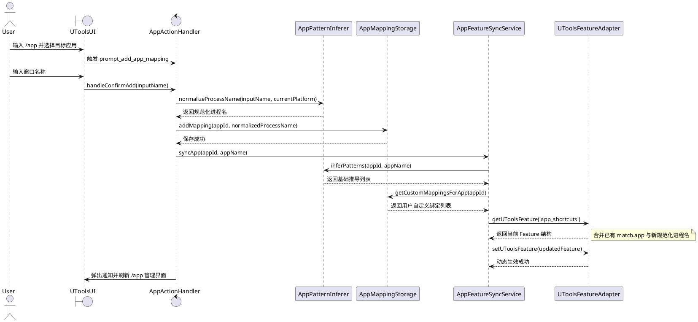
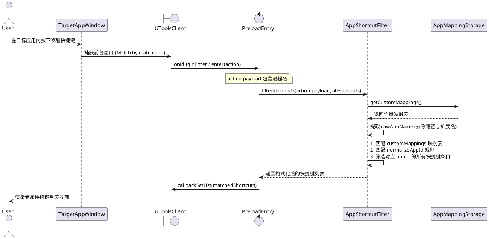

# SPEC-00021: 应用窗口名称匹配与快捷键动态筛选设计文档

## 1. 功能目标与背景

### 1.1 核心目标
解决用户通过 `/app` 命令管理或导入应用快捷键时，因“用户输入的窗口名称/显示名称”与“系统底层进程名 (`match.app`)”或“内部 `appId`”不一致导致的窗口无法识别与快捷键无法加载的问题：
1. **智能进程规范化与 uTools 窗口匹配 (`match.app`) 动态注册**：
   用户通过 `/app` 命令输入应用窗口名或进程名（如 `Google Chrome`、`Chrome`、`企业微信`、`Visual Studio Code`）后，系统能够智能推导并格式化为标准进程名（如 macOS 下自动推导并补全 `Google Chrome.app`，Windows 下推导 `chrome.exe` / `Code.exe`），并动态注入到 uTools 运行时 `features[code="app_shortcuts"].cmds[0].match.app` 列表中，使 uTools 能够精确捕获前台窗口。
2. **多维映射与快捷键筛选生成 uTools 列表**：
   建立 `Window/Process Name <---> Target AppId` 的双向索引映射机制。在前台应用中唤醒插件时，插件根据当前前台窗口进程信息，通过映射表精准过滤出属于该应用的快捷键数据，并转化为包含 `title`、`description`、`keys`、`icon` 的标准化 uTools 列表条目。

### 1.2 非目标 (Non-Goals)
- 本版本不修改已有的内置静态快捷键数据文件内容。
- 本版本不直接向本地磁盘写回 `plugin.json` 文件（遵循运行时 `utools.setFeature` 动态注册原则）。
- 本版本不涉及跨操作系统的按键映射自动转换算法修改。

---

## 2. 用户操作流程 (User Flow)

```
+-------------------------------------------------------------+
| 1. 用户在 uTools 中输入 /app 呼出应用管理列表                 |
+-------------------------------------------------------------+
                              |
                              v
+-------------------------------------------------------------+
| 2. 用户选择目标应用（例如 "企业微信" / appId: "wecom"）       |
+-------------------------------------------------------------+
                              |
                              v
+-------------------------------------------------------------+
| 3. 点击「添加进程映射」，输入窗口名称（例如 "WXWork" 或 "企业微信"）|
+-------------------------------------------------------------+
                              |
                              v
+-------------------------------------------------------------+
| 4. 系统自动执行进程名推导与规范化处理 (如补全 .app/.exe 及别名推导)|
+-------------------------------------------------------------+
                              |
                              v
+-------------------------------------------------------------+
| 5. 系统将推导出的标准进程名写入存储，并调用 utools.setFeature  |
|    动态扩展 features[app_shortcuts].cmds[0].match.app       |
+-------------------------------------------------------------+
                              |
                              v
+-------------------------------------------------------------+
| 6. 用户切换至该前台应用，呼出 uTools 插件                     |
+-------------------------------------------------------------+
                              |
                              v
+-------------------------------------------------------------+
| 7. uTools 捕获窗口进程，传递给 app_shortcuts 模式           |
+-------------------------------------------------------------+
                              |
                              v
+-------------------------------------------------------------+
| 8. 插件通过映射表精确匹配出该应用快捷键，生成并展示 uTools 列表|
+-------------------------------------------------------------+
```

---

## 3. 详细架构与逻辑设计

### 3.1 软件架构与模块设计 (PlantUML)



---

### 3.2 交互时序图 (PlantUML)

#### 场景 1：用户在 `/app` 中配置应用窗口名并动态注册 `match.app`



#### 场景 2：前台窗口唤醒与快捷键列表动态筛选生成



---

### 3.3 核心类与接口契约设计

#### 1. `AppPatternInferer` (进程名推导与规范化器)
- **职责**：负责将用户输入的任何形式的窗口名称、别名或未带后缀的名称，转换为操作系统符合 uTools `match.app` 要求的合法进程名。
- **接口契约**：
  - `normalizeProcessName(rawInput: String, isMac: Boolean): String`：
    - 去除前后空白字符与非法路径字符。
    - 若 `isMac === true` 且不以 `.app` 结尾，则自动追加 `.app` 后缀。
    - 若 `isMac === false` 且不以 `.exe` 结尾，则自动追加 `.exe` 后缀。
  - `inferPatterns(appId: String, appName: String): Array<String>`：
    - 根据应用 `appId`、`appName` 以及预设别名表 (`ALIAS_GROUPS`)，自动生成 Mac (`.app`) 和 Windows (`.exe`) 的默认候选进程列表。

#### 2. `AppMappingStorage` (应用与进程映射存储)
- **职责**：持久化管理用户在 `/app` 菜单中自定义绑定的进程名与 `appId` 的映射关系。
- **存储结构定义**：
  - Key: `utools_custom_app_mappings`
  - Value:
    ```json
    {
      "wecom": ["WXWork.app", "WXWork.exe"],
      "vscode": ["Visual Studio Code.app", "Code.exe"],
      "chrome": ["Google Chrome.app", "chrome.exe"]
    }
    ```

#### 3. `AppShortcutFilter` (快捷键多维匹配与生成器)
- **职责**：在 `app_shortcuts` 模式下，根据前台窗口进程信息筛选并组装快捷键列表。
- **匹配与过滤优先级算法 (Pseudocode)**：
  ```
  FUNCTION filterShortcuts(actionPayload, allShortcuts):
      rawProcessName = EXTRACT_PROCESS_NAME(actionPayload)
      cleanBaseName = GET_APP_NAME_WITHOUT_EXT(rawProcessName)
      normTargetId = NORMALIZE_APP_ID(cleanBaseName)
      customMappings = STORAGE.getCustomMappings()

      filteredList = []
      FOR EACH item IN allShortcuts:
          // 判定 1: 用户在 /app 中显式绑定的映射 (最高优先级)
          IF item.appId AND customMappings[item.appId] CONTAINS rawProcessName OR cleanBaseName:
              APPEND item TO filteredList
              CONTINUE

          // 判定 2: 标准化 AppId 精确匹配
          IF item.appId AND NORMALIZE_APP_ID(item.appId) == normTargetId:
              APPEND item TO filteredList
              CONTINUE

          // 判定 3: 无 appId 的遗留快捷键数据基于 keyword 模糊匹配
          IF NOT item.appId AND cleanBaseName IN item.keyword.toLowerCase():
              APPEND item TO filteredList

      SORT filteredList BY hitTimeStamp DESC
      RETURN filteredList
  ```

---

## 4. 测试用例设计 (Test Design)

| 用例编号 | 测试分类 | 输入 / 前置条件 | 预期输出 / 行为 |
| :--- | :--- | :--- | :--- |
| **TC-01** | 进程名规范化 | 用户输入 `WXWork` (macOS 平台) | 自动规范化为 `WXWork.app` |
| **TC-02** | 进程名规范化 | 用户输入 `code` (Windows 平台) | 自动规范化为 `code.exe` |
| **TC-03** | 进程名规范化 | 用户输入已带后缀 `Google Chrome.app` | 保持为 `Google Chrome.app`，不重复追加后缀 |
| **TC-04** | Feature 动态同步 | 为 `appId="wecom"` 添加 `WXWork.app` | `features[app_shortcuts].cmds[0].match.app` 成功包含 `WXWork.app` 并调用 `utools.setFeature` |
| **TC-05** | 前台窗口快捷键匹配 | 前台窗口传入 `WXWork.app`，已绑定 `wecom` | 精确返回 `appId="wecom"` 的所有快捷键，不返回其他应用快捷键 |
| **TC-06** | 大小写与路径容错 | 前台窗口传入 `/Applications/WXWork.app/Contents/MacOS/WXWork` | 正确提取 `WXWork.app` 并成功匹配 |
| **TC-07** | 默认别名推导匹配 | 前台窗口传入 `Code.exe`，未自定义绑定，快捷键 `appId="vscode"` | 通过 `ALIAS_GROUPS` 标准化匹配成功 |
| **TC-08** | 空输入与异常回退 | 用户输入纯空格或特殊字符 | 提示输入无效，不进行非法映射存储 |
