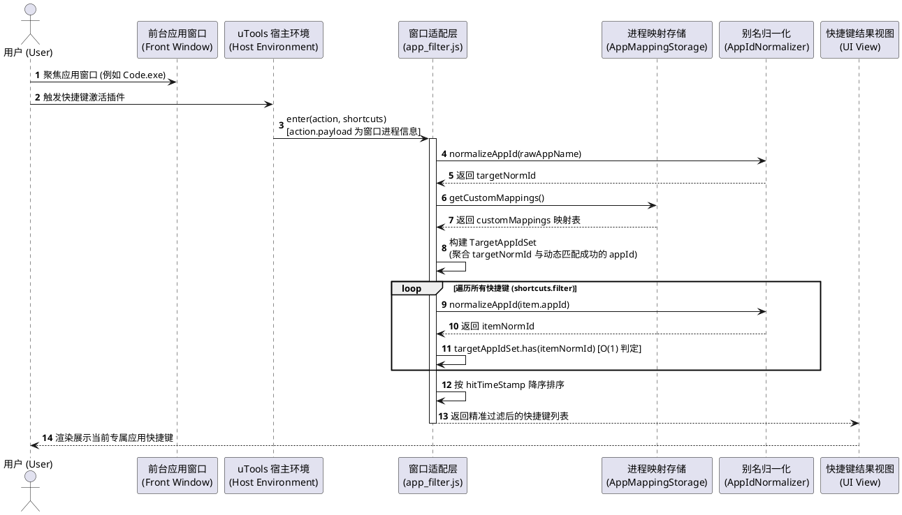
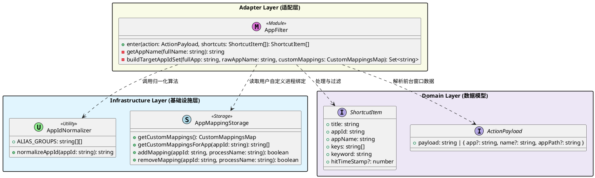
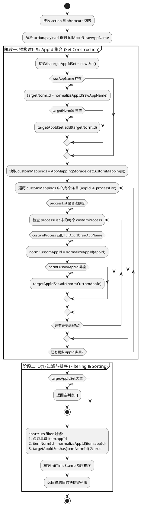

# SPEC-00023: 重构 app_filter 匹配算法与反向索引优化

## 1. 功能目标与背景

### 1.1 现状与问题分析
在「快捷键助手」插件中，当用户在前台应用窗口激活时唤出 uTools，插件通过 `app_filter.js` 响应 `app_shortcuts` 模式，过滤出仅属于当前活动窗口应用的快捷键列表。

在历史演进过程中，早期版本保留了如下基于关键字的模糊包含匹配作为兜底规则：
```javascript
// 历史模糊兜底规则
if (rawAppName && item.keyword && item.keyword.toLowerCase().indexOf(rawAppName) !== -1) {
    return true;
}
```

随着 [SPEC-00017: 应用名称别名标准化](file:///Users/guangyu/Projects/utools/utools_shortcut_keys/docs/spec/archive/spec-00017-app-matching-alias-normalization.md) 与 [SPEC-00019: 自定义应用进程名称斜线命令](file:///Users/guangyu/Projects/utools/utools_shortcut_keys/docs/spec/archive/spec-00019-custom-app-process-mapping.md) 的交付，系统已建立起标准化的 `AppIdNormalizer`（静态别名映射库）以及 `AppMappingStorage`（用户动态进程绑定机制），所有合法应用均已具备确定性的精确识别通道。

然而，现有 `app_filter.js` 仍存在以下两项架构技术债（记录于 [docs/spec/backlog.md: TD-0001](file:///Users/guangyu/Projects/utools/utools_shortcut_keys/docs/spec/backlog.md)）：
1. **跨应用快捷键误召回隐患 (False Positives)**：
   仍保留对无 `appId` 数据或模糊子串的兜底逻辑。当进程简称为 `code`、`tab`、`terminal`、`app` 时，其他应用（如 Chrome、Safari）若某条快捷键包含该关键字，可能被错误匹配并混杂在列表中。
2. **循环内部重复计算与性能开销 ($O(N \times M)$)**：
   在每次窗口呼出时，过滤循环内部对数千条快捷键中的每一个 `item` 重复调用 `normalizeAppId()` 正则替换，并反复遍历 `customMappings` 的进程数组及进行字符串比对，增加了不必要的 CPU 耗时与 GC 压力。

### 1.2 核心目标
1. **彻底废弃 `keyword` 模糊包含匹配**：
   完全移除基于 `item.keyword` 的模糊子串匹配机制，仅允许基于归一化 `appId` 的确定性匹配，彻底杜绝跨应用串台。
2. **预构建目标应用集合反向索引 (Inverted Target App ID Set, $O(1)$ 匹配)**：
   在执行过滤循环前，先根据前台窗口进程信息与 `customMappings` 一次性构建当前窗口对应的 `targetAppIdSet`，将过滤核心判断复杂度降至 $O(1)$ 哈希命中。
3. **保证向下兼容与行为一致性**：
   无缝兼容系统内置别名映射（如 VS Code / MarginNote / Directory Opus 等）与用户通过 `/app` 命令自定义绑定的进程映射，维持搜索结果基于 `hitTimeStamp` 的降序排列。

### 1.3 非目标 (Non-Goals)
- 本设计不修改全局搜索框（`hk` 主命令）基于标题/关键词的文本搜索行为。
- 本设计不更改 `AppMappingStorage` 的存储协议与 `/app` 交互向导逻辑。
- 本设计不修改 `AppIdNormalizer` 的基础别名表结构。

---

## 2. 用户操作流程与交互时序 (User Flow)

用户在前台应用窗口呼出快捷键插件时的系统交互流程如下：



---

## 3. 详细架构与逻辑设计

### 3.1 软件模块架构与类图

系统分层严格遵循插件的核心架构规范：



### 3.2 匹配机制反向索引构建核心逻辑

在 `appFilter` 处理前台窗口进入事件时，匹配逻辑拆解为两大阶段：



### 3.3 算法设计与抽象伪代码

#### 3.3.1 目标应用集合构建函数 (`buildTargetAppIdSet`)
```text
FUNCTION buildTargetAppIdSet(fullApp, rawAppName, customMappings):
    targetAppIdSet = NEW Set()
    
    IF rawAppName IS NOT EMPTY:
        targetNormId = normalizeAppId(rawAppName)
        IF targetNormId IS NOT EMPTY:
            targetAppIdSet.add(targetNormId)
            
    IF customMappings IS NOT NULL AND TYPE IS OBJECT:
        FOR EACH (appId, processList) IN customMappings:
            IF processList IS ARRAY:
                FOR EACH processName IN processList:
                    cleanProcess = TRIM(processName)
                    IF cleanProcess IS EMPTY:
                        CONTINUE
                    
                    isMatched = FALSE
                    IF fullApp IS NOT EMPTY AND LOWER(cleanProcess) == LOWER(fullApp):
                        isMatched = TRUE
                    ELSE:
                        cleanBase = getAppName(cleanProcess)
                        IF rawAppName IS NOT EMPTY AND LOWER(cleanBase) == LOWER(rawAppName):
                            isMatched = TRUE
                            
                    IF isMatched:
                        normMappedId = normalizeAppId(appId)
                        IF normMappedId IS NOT EMPTY:
                            targetAppIdSet.add(normMappedId)
                        BREAK
                        
    RETURN targetAppIdSet
END FUNCTION
```

#### 3.3.2 快捷键主过滤函数 (`enter`)
```text
FUNCTION enter(action, shortcuts):
    // 1. 初始化快捷键元数据与时间戳
    INITIALIZE hitTimeStamps FROM dbStorage
    FOR EACH item IN shortcuts:
        ENSURE item.keyword CONTAINS item.title
        item.hitTimeStamp = hitTimeStamps[item.title] DEFAULT 0

    // 2. 解析前台应用进程信息
    fullApp = EXTRACT_FULL_APP(action)
    rawAppName = getAppName(fullApp)
    
    // 3. 预构建匹配索引表
    customMappings = AppMappingStorage.getCustomMappings()
    targetAppIdSet = buildTargetAppIdSet(fullApp, rawAppName, customMappings)
    
    IF targetAppIdSet.size == 0:
        RETURN []
        
    // 4. 精准 O(1) 过滤（彻底移除 keyword 模糊匹配）
    filtered = FILTER item IN shortcuts WHERE:
        item.appId IS NOT EMPTY AND
        targetAppIdSet.has(normalizeAppId(item.appId))
        
    // 5. 排序并返回
    SORT filtered BY hitTimeStamp DESCENDING
    RETURN filtered
END FUNCTION
```

### 3.4 边界条件与异常处理
1. **`action` 或 `action.payload` 为空/非法**：
   - `fullApp` 与 `rawAppName` 均为空字符串，`targetAppIdSet` 为空，直接返回 `[]`，不会抛出异常。
2. **`shortcuts` 中存在无 `appId` 的旧数据**：
   - 彻底予以忽略（返回 `false`），不再通过 `item.keyword` 模糊召回，确保跨应用完全隔离。
3. **`customMappings` 数据格式异常（如损坏的 JSON 或非对象）**：
   - `AppMappingStorage` 内部已做类型守卫，返回 `{}`；`buildTargetAppIdSet` 安全跳过。
4. **macOS 完整路径与 Windows 带 `.exe` 后缀的统一处理**：
   - 继续使用经过验证的 `getAppName()` 工具函数，抹平路径分隔符（`/` 与 `\`）并剥离扩展名。

---

## 4. 测试用例设计 (Test Design)

测试用例设计覆盖精准匹配、自定义映射、跨应用隔离、边界输入及排序机制：

| 用例编号 | 测试场景 | 前置输入 / 条件 | 预期结果 |
| :--- | :--- | :--- | :--- |
| **TC-001** | 标准别名精准匹配 (macOS Bundle) | 前台窗口为 `Visual Studio Code.app`，包含 VSCode / Chrome 快捷键 | 仅返回 VSCode 快捷键，`appId === 'visual-studio-code'` |
| **TC-002** | 标准别名精准匹配 (Windows EXE) | 前台窗口为 `Code.exe` 或 `CodeArts-IDE.exe` | 精准匹配并仅返回 VSCode 快捷键 |
| **TC-003** | 自定义进程映射匹配 (SPEC-00019) | `customMappings` 配置 `one-commander` -> `['OneCommanderCustom.exe']`，前台窗口为 `OneCommanderCustom.exe` | 精准返回 One Commander 快捷键 |
| **TC-004** | 跨应用关键字防串台隔离 (核心技术债验证) | 快捷键 A 为 Chrome (`appId: google-chrome`)，快捷键 B 为 LazyNvim (`appId: lazynvim`, `keyword` 中包含 `chrome dopus`)，前台激活 Chrome | 仅返回 Chrome 快捷键，绝不泄露 LazyNvim 快捷键 |
| **TC-005** | 彻底废弃无 `appId` 遗留数据的模糊召回 | 条目无 `appId`，但 `keyword` 包含 `code`，前台为 `Code.exe` | 返回结果中**不包含**该遗留条目（严格隔离） |
| **TC-006** | 未知/未配置的应用前台窗口 | 前台为 `UnknownApp_123.exe`，无别名也无自定义映射 | 返回空数组 `[]` |
| **TC-007** | 空输入与异常输入容错 | `action` 为 `null`、`undefined` 或 `{ payload: '' }` | 返回空数组 `[]`，不崩溃 |
| **TC-008** | 时间戳降序排序验证 | 命中 2 条 VSCode 快捷键，一条 `hitTimeStamp` 为 500，另一条为 100 | 按时间戳降序正确返回，500 的条目排在首位 |
| **TC-009** | 路径格式兼容性 | 前台为完整路径 `/Applications/Google Chrome.app` 与 `C:\Tools\chrome.exe` | 均能正确提取进程基础名并命中 `google-chrome` |
| **TC-010** | 单次调用构建索引性能与纯函数独立性 | 提供包含 5000+ 条多应用混杂的快捷键大数组 | 耗时显著低于 1ms，且不产生任何状态污染 |

---

## 5. 依赖与影响评估

- **代码修改范围**:
  - `src/adapter/app_filter.js`：核心过滤重构。
  - `test/test_app_filter.js`：更新测试用例（移除针对遗留无 `appId` 模糊匹配的用例 TC-005，替换为严格隔离断言）。
  - `docs/spec/backlog.md`：在实现完成后将 TD-0001 标记为已完成。
- **用户透明度**:
  - 纯内部架构与性能重构，不产生任何破坏性 API 变更，用户感知为快捷键推荐更加精准且无串台。
